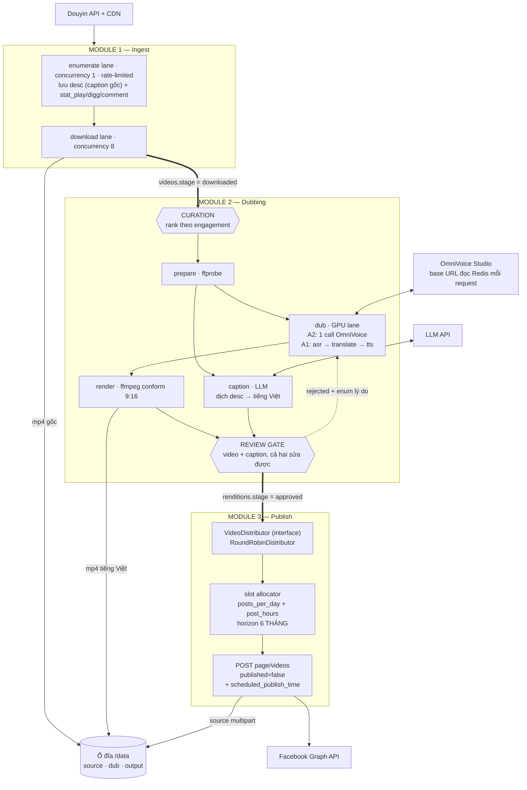
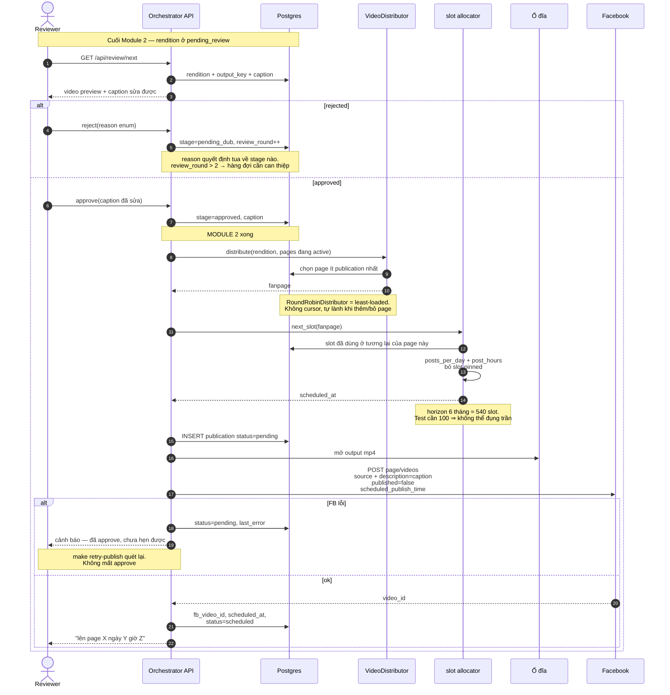

# Solution Design: Reup Pipeline — Douyin → Dub tiếng Việt → Facebook

**Author:** Solution Architect (via /solution-design)
**Date:** 2026-08-24 · **Rev 3**
**Refs:** `IDEA.md` (spec pha download) · supersedes `solution-design-2026-08-24-douyin-bulk-downloader.md`
**Status:** draft

**Lịch sử revision** — giữ lại vì mỗi lần đều là một quyết định bị lật bởi thông tin mới:
- **Rev 1** — scope pipeline 4 ngôn ngữ, tự xây scheduler, MinIO, OCR chữ Trung.
- **Rev 2** — FB native scheduling · 1 ngôn ngữ (tiếng Việt) · bỏ OCR.
- **Rev 3** — **`/{page-id}/videos` thay cho `video_reels`** (lật D3, xoá 3 ràng buộc) · **ổ đĩa thay MinIO** · token paste per-page, không Business Manager · distributor interface · caption pipeline.
- **Rev 3.1** — sửa §2/§4 D6: thời hạn page token là **nhị phân** (vài giờ hoặc không hết hạn), không phải ngưỡng 7 ngày như Rev 3 viết sai.
- **Rev 3.2** — D6 đổi sang **Approach 1.5**: dán **một** user token ngắn hạn, tool tự `fb_exchange_token` + `/me/accounts`. Thêm §2.6.1 về App Review.
- **Rev 5** — **D2 GIẢI QUYẾT** bằng scout code OmniVoice Studio: `POST /batch/enqueue` làm trọn gói demucs + ASR + dịch + TTS clone + mix, `preserve_bg=true`, tiếng Việt first-class. Module 2 **rút còn 3 lane**; bỏ `@anthropic-ai/sdk`; thêm `talent_glossary`.
- **Rev 4** — **Tool viết bằng TypeScript / NestJS**; parser giữ Python. Thêm D7 (data access layer). **§7.2 thay dự đoán bằng khảo sát thật trên fork tại `src/Douyin_TikTok_Download_API` — patch chỉ 1 dòng + 1 file, và phát hiện một cookie thật đang bị commit vào fork public.**

---

## 1. Context

Agency quản lý talent Douyin, mở rộng sang thị trường Việt Nam. Tool internal, **3 module = 3 milestone**:

```
Module 1 — Ingest      Douyin → mp4 gốc + caption gốc trên ổ đĩa
Module 2 — Dubbing     mp4 gốc → mp4 tiếng Việt + caption tiếng Việt, kết thúc bằng REVIEW GATE
Module 3 — Publish     mp4 đã duyệt → hẹn giờ lên fanpage qua Graph API
```

**Nguyên tắc kiến trúc số 1: ba module chỉ nối nhau qua state trong DB.** Module 3 không biết mp4 tới `approved` bằng cách nào — nạp tay cũng chạy. Không HTTP call, không message, không import xuyên module. Có `test_module_isolation.py` bảo vệ.

### Đã chốt

| | Chốt | Vòng |
|---|---|---|
| Dubbing engine | **OmniVoice Studio** qua HTTP, self-host / Colab | Q&A 1 |
| Review gate | **Bắt buộc**, về chất lượng video final, cuối Module 2 | Q&A 2 |
| Giọng đọc | **Voice clone theo talent** | Q&A 1 |
| Ngôn ngữ đích | **Chỉ tiếng Việt** | Q&A 2 |
| Chữ Trung burned-in | **Bỏ qua, không OCR** | Q&A 2 |
| Chia video cho page | **Interface + `RoundRobinDistributor`**, impl khác viết sau | Q&A 3 |
| Caption | **Dịch caption gốc** ⇒ Module 1 lưu caption | Q&A 3 |
| **Ngôn ngữ tool** | **TypeScript / NestJS.** Parser giữ Python, chỉ patch cookie | Q&A 5 |
| Storage | **Ổ đĩa, không MinIO** — xem §2 D5 | Q&A 3 |
| Facebook auth | **Dán 1 user token ngắn hạn, tool tự lấy hết page token.** Không Business Manager, không App Review | Q&A 3–4 |
| Loại post | **`/{page-id}/videos`, không phải Reels API** — xem §2 D3 | Q&A 3 |
| Đánh giá page/video "ăn đề xuất" | Người làm, ngoài phạm vi tool | Q&A 2 |

### Quy mô

| | Test | Mở rộng |
|---|---|---|
| Fanpage | 10 | ~100 |
| Video cần dub | 1.000 | theo nhu cầu |
| Post/page/ngày | 3 | 3–5 |
| Tổng post/ngày | 30 | 300–500 |

### Constraints kế thừa từ `IDEA.md`
Rate limit enumerate ~100–150 req/giờ/IP tuần tự vs download CDN song song · `play_addr` hết hạn · cookie là credential không log · cookie bị ban → `blocked` giữ checkpoint · parser fork diff ≤50 dòng.

### Non-goals
Platform khác Facebook · nhiều ngôn ngữ (thiết kế để mở, không làm) · phân tích hiệu quả page/video · xoá chữ burned-in · edit video ngoài conform · multi-tenant.

---

## 2. Approaches Evaluated

---

### D3 — Reels API hay `/{page-id}/videos`? *(lật quyết định Rev 2)*

Câu hỏi của bạn: *"tại sao làm Reels mà không phải dạng post có video bình thường?"* — Verify xong thì đây là quyết định tốt hơn ở gần như mọi chiều.

#### Approach 1: `POST /{page-id}/video_reels` *(Rev 2 chọn cái này)*

| | |
|---|---|
| Upload | **3 phase**: `start` → `rupload.facebook.com` → `finish` |
| Scheduling | `video_state=SCHEDULED` + `scheduled_publish_time`, **>10 phút và <29 ngày** |
| Duration | **3–90 giây bắt buộc** |
| Aspect | **9:16 bắt buộc**, ≥540×960 |
| Read / update / delete | **Không hỗ trợ** |
| Publish cap | 30 / page / 24h |

**Pros:** là surface Reels một cách tường minh, không phụ thuộc hành vi auto-convert của Meta.
**Cons:** cả bốn dòng in đậm ở trên. Ba trong số đó là ràng buộc mà thiết kế Rev 2 phải cõng: horizon 29 ngày sinh ra top-up lane, gate 3–90s sinh ra trạng thái `ineligible`, và không delete được sinh ra "runbook takedown tay".

#### Approach 2: `POST /{page-id}/videos` *(khuyến nghị)*

| | |
|---|---|
| Upload | **1 lời gọi** — `source` multipart hoặc `file_url` |
| Scheduling | `published=false` + `scheduled_publish_time`, **>10 phút và <6 THÁNG** |
| Duration | **không nêu giới hạn** trong docs |
| Aspect | **không nêu giới hạn** |
| Read / update / delete | **Có** — qua video node (`GET`/`POST`/`DELETE /{video-id}`) |
| Permissions | `pages_manage_posts`, `pages_read_engagement`, `pages_show_list` — **y hệt** |
| Deprecated? | **Không.** Vẫn có trong Graph API reference v25.0 |

**Và mảnh ghép quyết định:** từ 06/2025 Meta công bố **mọi video upload lên Facebook đều thành Reels** — đổi tab "Videos" thành "Reels" và **bỏ giới hạn 90 giây cho Reels**. Nghĩa là post qua `/videos` **vẫn vào surface Reels**, nhưng không phải chịu ba ràng buộc mà Reels API áp ở tầng API.

**Pros:**
- **Horizon 6 tháng thay vì 29 ngày** ⇒ **xoá luôn top-up lane của D4.** 100 video/page ở 3/ngày = 34 ngày, nằm thoải mái trong 6 tháng ⇒ hẹn hết một lượt lúc approve.
- **Delete/update được** ⇒ lấy lại đúng năng lực mà Rev 2 phải chấp nhận mất. Talent rời agency, khiếu nại bản quyền → `DELETE /{video-id}`, có code, không cần runbook tay.
- **Read được** ⇒ biết bài đã đăng thật chưa. Không còn fire-and-forget mù.
- **Không gate 3–90 giây** ⇒ **trả lời trực tiếp câu 5 của bạn: "không biết trước % video >90s" không còn là vấn đề cần biết trước.** Trạng thái `ineligible` gần như biến mất.
- **Upload 1 lời gọi thay vì 3 phase** ⇒ ít code hơn, ít điểm lỗi hơn.
**Cons:**
- Phân phối Reels dựa trên **hành vi auto-convert của Meta**, không phải hợp đồng API. Nếu Meta đổi ý hoặc rollout chưa tới page nào đó, video có thể chỉ là video post thường (reach kém hơn nhiều với page 0 follower).
- Docs `/videos` không nêu giới hạn duration/aspect, nhưng "không nêu" ≠ "không có". Cần xác nhận thực nghiệm.
- Aspect ratio vẫn quan trọng cho **hiệu quả** dù không bị enforce — 9:16 hiển thị tốt hơn trong feed Reels.

#### Approach 3: Dùng cả hai — `/videos` mặc định, `video_reels` cho video 3–90s + 9:16

**Pros:** video đủ điều kiện đi đường Reels tường minh (chắc chắn được phân phối Reels), phần còn lại đi `/videos`.
**Cons:** hai code path publish, hai loại lỗi, hai cơ chế scheduling với hai horizon khác nhau (29 ngày vs 6 tháng) — và logic slot phải biết mỗi publication dùng horizon nào. Độ phức tạp tăng gấp đôi để đổi lấy một điều **chưa chứng minh là có lợi**. Chỉ đáng làm nếu spike cho thấy `/videos` thật sự không được phân phối Reels.

---

### D4 — Gán slot lúc nào? *(đơn giản đi hẳn nhờ D3)*

#### Approach 1: Gán slot ngay lúc approve *(khuyến nghị)*

Reviewer bấm approve → distributor chọn page → slot allocator lấy khe trống kế tiếp → gọi FB ngay với `published=false` + `scheduled_publish_time`.

**Pros:**
- **Không có lane định kỳ nào cả.** Approve là xong. Đây là toàn bộ phần "scheduler" của hệ thống.
- Reviewer thấy ngay "bài này sẽ lên page X ngày Y" — feedback tức thì, không phải chờ 24h.
- Ở horizon 6 tháng, page 3 post/ngày có **~540 slot** hẹn trước được. 1.000 video / 10 page = 100/page ⇒ dùng 18% horizon. Không thể đụng trần.
**Cons:** nếu FB lỗi lúc approve thì reviewer thấy lỗi. Xử lý: publication vào `pending`, một lệnh `make retry-publish` quét lại — không cần lane thường trực.

#### Approach 2: Lane top-up chạy mỗi ngày *(Rev 2 chọn cái này)*

**Pros:** tách rời duyệt khỏi hẹn; chịu được horizon hẹp.
**Cons:** **lý do tồn tại của nó là trần 29 ngày, và D3-A2 đã xoá trần đó.** Giữ lại nghĩa là cõng một lane định kỳ + alert "lane không chạy hôm nay" cho một vấn đề không còn tồn tại.

#### Approach 3: Người tự gán qua UI calendar
Vẫn giữ **chồng lên A1** dưới dạng `publications.pinned` + API reschedule: ghim/đổi giờ một bài cụ thể. Không phải cơ chế chính (30–500 thao tác tay/ngày là bất khả thi), nhưng cần có để can thiệp.

---

### D5 — MinIO hay ổ đĩa? *(bạn hỏi lợi ích của MinIO — đây là câu trả lời thật)*

#### Approach 1: MinIO / S3-compatible *(Rev 1–2 chọn cái này)*

**Lợi ích thật của MinIO:**
1. **Presigned URL** ⇒ Facebook tự pull file, không tốn egress qua app.
2. **API S3** ⇒ đổi sang S3/R2 thật sau này không sửa code.
3. **Nhiều máy worker dùng chung storage** — cần khi tách máy app và máy GPU.
4. Serve file qua HTTP cho video player trong review UI, không cần tự viết.

**Nhưng ở bối cảnh này cả bốn đều yếu đi:**
1. `/videos` nhận `source` multipart ⇒ upload 15MB trực tiếp là chuyện nhỏ. **Presigned URL không còn cần thiết** — và nó vốn đòi MinIO phải reachable từ internet, tức thêm một bề mặt phải bảo vệ.
2. Đổi sang S3 sau này giải quyết được bằng **một interface Storage** — cùng đúng cái pattern bạn vừa yêu cầu cho distributor.
3. Một máy, một worker container. Khi nào tách máy thì đổi implementation của interface.
4. FastAPI `FileResponse` sau một signed token ≈ 30 dòng.

**Cái giá của MinIO mà Rev 1–2 không tính:** pipeline này **nặng ffmpeg**. Mỗi stage ffmpeg với MinIO là *download → xử lý → upload*. Với ~2 stage ffmpeg × 1.000 video × ~15–25MB, đó là **60–90 GB HTTP round trip nội bộ hoàn toàn vô ích**, cộng thêm code tạm-file ở mọi lane. Với ổ đĩa, ffmpeg nhận một đường dẫn.

#### Approach 2: Ổ đĩa + interface `Storage` *(khuyến nghị)*

Layout: `/data/source/{sec_user_id}/{aweme_id}.mp4` · `/data/dub/{rendition_id}.wav` · `/data/output/{rendition_id}.mp4`

**Pros:**
- **Bỏ một service khỏi docker-compose** cùng với credential và bucket policy của nó.
- ffmpeg đọc/ghi đường dẫn trực tiếp — bỏ 60–90 GB transfer vô ích và bỏ code tạm-file ở mọi lane.
- Backup là `rsync`. Với dữ liệu **tái tạo lại được** (mp4 gốc tải lại từ Douyin, output dub lại bằng GPU) thì đây là mức durability đúng — không cần replication.
- Dung lượng: **~25 GB** cho giai đoạn test. Vài trăm GB khi mở rộng. Một ổ đĩa lo được.
**Cons:**
- Một máy. Tách máy GPU sau này cần NFS hoặc đổi implementation.
- Không có lifecycle policy sẵn — phải tự viết job xoá file cũ (một dòng `find -mtime`).
- Đầy đĩa là lỗi cứng. Cần preflight check + alert ngưỡng.

**Interface giữ đường lùi** — cùng pattern với distributor:
```python
class Storage(Protocol):
    def path_for(self, kind: str, key: str) -> Path        # ffmpeg dùng trực tiếp
    def put(self, kind: str, key: str, src: Path) -> str
    def open(self, kind: str, key: str) -> BinaryIO
    def signed_url(self, kind: str, key: str, ttl: int) -> str
```
`LocalDiskStorage` hôm nay, `S3Storage` khi cần. Chỉ `path_for` là thứ S3 không làm được nguyên bản — nên **mọi lane ffmpeg phải đi qua `path_for`**, và `S3Storage.path_for` sẽ là download-vào-tmp-rồi-trả-path. Ghi rõ điều này vào docstring, vì đây là chỗ một implementation tương lai sẽ âm thầm chậm đi 10 lần.

---

### D6 — Quản lý Facebook page token *(không Business Manager)*

Tin tốt đã verify: **`pages_manage_posts` ở Standard Access hoạt động cho page mà chính developer/admin của app quản lý ⇒ không cần App Review, không cần Business Verification.** Rủi ro "Meta app review chặn Module 3" mà Rev 2 nêu **biến mất** với hướng đi này. Đổi lại phải xử lý token expiry bằng tay.

#### Approach 1: Paste page token từng page *(bạn chọn — khuyến nghị cho v1)*

Trang quản lý page: thêm page → dán `fb_page_id` + page token.

**Pros:**
- **Không cần OAuth redirect, không cần App Review, không cần Business Manager.** Ít hạ tầng nhất và chạy được ngay.
- Mỗi page độc lập — một token hỏng không ảnh hưởng page khác.
- Phù hợp giai đoạn test 10 page: 10 lần dán.
**Cons — và đây là chỗ phải thiết kế cẩn thận:**
- **Thời hạn của page token là NHỊ PHÂN, không phải một dải liên tục.** Nó thừa hưởng từ user token sinh ra nó, và chỉ có hai trường hợp:

  | Page token sinh từ | Thời hạn |
  |---|---|
  | User token **ngắn hạn** (mặc định của Graph API Explorer) | **hết hạn sau vài giờ** |
  | User token **dài hạn** (đã đổi qua `GET oauth/access_token` + app secret) | **không có ngày hết hạn** — docs Meta: *"Long-lived Page access token do not have an expiration date and only expire or are invalidated under certain conditions"* |

  Không có trường hợp "page token còn 5 ngày". Nên phép kiểm lúc dán là **nhị phân**, không phải ngưỡng.
- **60 ngày là thời hạn của USER token, không phải của page token.** Đây là chỗ dễ nhầm nhất: user token dài hạn sống 60 ngày, nhưng page token sinh ra từ nó thì không có ngày hết hạn.
- "Không có ngày hết hạn" **không phải bất tử.** Nó vẫn bị vô hiệu khi: người dùng đổi mật khẩu · thu hồi quyền của app · mất vai trò admin trên page · app bị xoá quyền · Meta phát hiện bất thường. Nên vẫn cần health check, và phép kiểm lúc dán **chỉ chặn đúng một loại lỗi: dán sai loại token**.
- **Không có refresh endpoint cho page token.** Muốn token mới phải đổi user token mới rồi gọi lại `/me/accounts`.
- **Không có refresh endpoint cho page token.** Muốn có token mới phải đổi user token mới rồi gọi lại `/me/accounts`.
- Ở 100 page, dán tay 100 lần và làm lại khi hỏng là công việc thật.

**Bắt buộc phải có, không phải nice-to-have:**
1. **Validate lúc dán** bằng `GET /debug_token` → đọc `expires_at`, `scopes`, `type`, và `profile_id`/`page_id` mà token thật sự trỏ tới. **Từ chối mọi token có `expires_at` là một thời điểm trong tương lai gần** — chỉ nhận token **không có ngày hết hạn** (`expires_at` = 0 hoặc vắng mặt). Kèm hướng dẫn cách đổi sang user token dài hạn rồi lấy lại page token. Đây là phép kiểm nhị phân, không phải ngưỡng — xem bảng ở trên.
2. **Health check hàng ngày** cho từng page → `fanpages.token_status ∈ {ok, expiring, invalid}` + badge đỏ trên UI.
3. Không bao giờ log token, không bao giờ trả token trong API response.

#### Approach 1.5: Dán **một** user token ngắn hạn, tool tự exchange + `/me/accounts` *(khuyến nghị)*

Người dùng dán **một ô duy nhất**: user token ngắn hạn lấy từ Graph API Explorer. Tool làm phần còn lại.

```
Người dùng (một lần, thủ công)
  Graph API Explorer → chọn app → tick pages_show_list + pages_read_engagement
                                       + pages_manage_posts → Generate Access Token
  → copy user token ngắn hạn (~1 giờ)
        │
        ▼  dán vào tool, MỘT ô
Tool (tự động, server-side)
  1. GET /oauth/access_token?grant_type=fb_exchange_token
       &client_id=APP_ID&client_secret=APP_SECRET&fb_exchange_token=<đã dán>
     → user token dài hạn (60 ngày)
  2. GET /me/accounts?fields=id,name,access_token
     → TOÀN BỘ page người đó quản lý + page token KHÔNG HẾT HẠN, một lời gọi
  3. upsert fanpages, mã hoá Fernet, token_never_expires = true
```

**Không cần App Review** — xem §2.6.1.

**Pros:**
- **Một lần dán thay cho 100 lần.** Ở 100 page, A1 là công việc lặp lại còn A1.5 là một thao tác.
- **Tool tự exchange nên nó biết chắc token thuộc loại đúng.** Phép kiểm `expires_at == 0` chuyển từ *chặn lỗi người dùng* thành *assertion nội bộ* — cả một loại lỗi vận hành biến mất chứ không phải được phát hiện sớm.
- **Không cần OAuth redirect, callback URL, app domain, Login dialog config.** Đó là toàn bộ chi phí hạ tầng khiến A2 đắt hơn, và A1.5 không phải trả.
- Tự phát hiện page mới: gọi lại `/me/accounts`, không phải dán thêm.
- Page token thu được **không có ngày hết hạn** ⇒ user token 60 ngày hết hạn **không ảnh hưởng việc đăng bài**; nó chỉ cần còn hiệu lực nếu muốn gọi lại `/me/accounts`.

**Cons:**
- **App secret phải nằm trong env của tool.** Hợp lý với internal tool server-side, nhưng là secret thứ ba phải quản (cùng `API_KEY`, `FERNET_KEY`) và là secret **mạnh nhất** trong ba — rò nó nghĩa là mạo danh được app.
- Vẫn cần một lần vào Graph API Explorer thủ công.
- Lưu thêm long-lived user token (mã hoá) nếu muốn re-sync page về sau.

#### Approach 2: FB Login trong tool → `GET /me/accounts`

Một nút "Kết nối Facebook". Người dùng đăng nhập một lần, tool gọi `/me/accounts` **lấy về toàn bộ page họ quản lý kèm page token trong một lời gọi**, rồi exchange sang long-lived.

**Pros:** một lần đăng nhập thay cho 100 lần dán; token tự lấy đúng loại dài hạn; tự phát hiện page mới.
**Cons:** cần OAuth redirect (một endpoint callback + app domain), và một FB app config thêm. Không nhiều nhưng là hạ tầng thật.

#### 2.6.1 — Exchange token có cần App Review không? **Không.**

Câu này dễ nhầm vì App Review nghe như một cổng chặn chung, nhưng nó **chỉ chặn permission (scope), không chặn endpoint**.

| Bước | Bị App Review chặn? |
|---|---|
| Lấy user token có scope `pages_show_list` / `pages_read_engagement` / `pages_manage_posts` | **Đây là bước DUY NHẤT liên quan tới access level.** Standard Access đủ cho người **có vai trò trên app** (admin / developer / tester) và page họ quản lý ⇒ **không cần review.** Review chỉ cần khi app đăng bài hộ page **không thuộc quyền quản lý của developer** (Advanced Access + Business Verification) |
| `GET /oauth/access_token?grant_type=fb_exchange_token` | **Không.** Chỉ cần `client_id` + `client_secret` + token ngắn hạn. Không phải một permission — là thao tác OAuth thuần của app với chính nó |
| `GET /me/accounts` | Không, ngoài scope `pages_show_list` đã có ở bước 1 |
| `POST /{page-id}/videos` | Không, ngoài scope `pages_manage_posts` đã có ở bước 1 |

**Cổng duy nhất nằm ở bước 1, và bối cảnh của bạn đã đi qua nó** — agency quản lý các page đó, và người vận hành tool được thêm làm admin/developer/tester của app. App để ở **Development mode** là đủ: Development mode chỉ hoạt động cho người có vai trò trên app, mà đó chính xác là định nghĩa của một internal tool.

**Một câu trong docs nghe đáng lo nhưng không áp vào ta:** *"Long-lived tokens do not auto-renew. Before the 60-day window closes, your application should prompt the user to re-authorize."* — câu đó nói về **user token**. Page token thu được từ nó **không có ngày hết hạn**, nên user token hết hạn sau 60 ngày **không làm rớt việc đăng bài**. Nó chỉ cần còn hiệu lực nếu muốn gọi lại `/me/accounts` để đồng bộ page mới.

### D7 — Data access layer *(mới ở Rev 4 — quyết định thật vì `SKIP LOCKED` là trung tâm)*

Với D1 (Postgres-as-queue), câu truy vấn quan trọng nhất của cả hệ thống là:

```sql
SELECT * FROM renditions
WHERE stage = $1 AND status = 'ready'
  AND (next_attempt_at IS NULL OR next_attempt_at <= now())
ORDER BY created_at LIMIT 1
FOR UPDATE SKIP LOCKED
```

Nên tiêu chí số 1 không phải "ORM nào đẹp nhất" mà là **`FOR UPDATE SKIP LOCKED` có phải công dân hạng nhất hay không.**

#### Approach 1: Drizzle ORM *(khuyến nghị)*
`.for('update', { skipLocked: true })` là API first-class, có type. Migration bằng `drizzle-kit generate` (sinh SQL thật, đọc và sửa được). Không có engine binary riêng.

**Pros:** câu claim viết bằng chính query builder có type, không rơi ra raw SQL · schema là TypeScript nên `stage` enum dùng chung được giữa DB và Lane registry (D1 cần đúng điều này) · migration là file SQL thường, review được trong PR · image Docker nhỏ, không có Rust/engine binary.
**Cons:** ecosystem non hơn Prisma, ít tài liệu hơn · không có studio/GUI mạnh bằng · relational query API còn thô ở quan hệ sâu.

#### Approach 2: Prisma
**Pros:** DX tốt nhất, migration chín, `prisma studio` để soi dữ liệu.
**Cons:** **`SKIP LOCKED` phải viết bằng `$queryRaw`** ⇒ câu quan trọng nhất của hệ thống rơi ra khỏi tầng type-safe, và kiểu trả về phải tự khai. Engine binary làm image nặng hơn và thêm một tiến trình con. Với schema mà *hàng chính là hàng đợi*, mất type ở đúng câu claim là mất ở chỗ đau nhất.

#### Approach 3: TypeORM
**Pros:** mặc định trong nhiều tài liệu NestJS, có `setLock('pessimistic_write')` + `setOnLocked('skip_locked')`.
**Cons:** migration và metadata decorator dễ lệch với schema thật; `synchronize` là bẫy trong production. Ecosystem đang chững lại so với Drizzle/Prisma.

---

### D1 — Execution model *(giữ nguyên qua cả 4 rev, nhưng lập luận đổi vì đã là Node)*

**Approach 1 (khuyến nghị): asset state machine trên Postgres.** Mỗi asset một hàng với `stage` + `status`; mỗi stage một lane claim bằng `FOR UPDATE SKIP LOCKED` + lease; chuyển stage atomic với ghi artifact. Không broker.
- Khớp trực tiếp với ranh giới 3 module: bảng = module.
- Review gate là **một giá trị `stage`**, không giữ tài nguyên, chờ bao lâu cũng được.
- Concurrency per-stage là con số config độc lập — GPU chỉ có một endpoint.
- `GROUP BY stage, status` vừa là dashboard vừa là query UI cần.

**Approach 2: BullMQ + `@nestjs/bullmq`.** Giờ đây đây là phương án *hấp dẫn nhất về mặt hệ sinh thái* — BullMQ là chuẩn de-facto của Node, có tích hợp NestJS first-class, có `FlowProducer` cho DAG, có Bull Board để soi queue. Vẫn loại, vì ba lý do **không đổi khi sang Node**:
- **Review gate chờ hàng giờ→hàng ngày phá vỡ mô hình job.** Job phải hoặc treo giữ slot, hoặc bị cắt làm hai với phần nối tự quản — tức là quay về A1 nhưng cõng thêm Redis làm nguồn chân lý thứ hai.
- **Chain/flow là một đối tượng xuyên suốt 3 module** ⇒ phá đúng thuộc tính "module chạy độc lập" của nguyên tắc kiến trúc số 1. Muốn chạy Module 3 riêng phải enqueue vào giữa flow.
- **Concurrency của BullMQ là per-worker-process.** GPU chỉ có một endpoint ⇒ vẫn phải tự viết semaphore phân tán. Ta tự làm đúng việc mà framework đáng ra lo giúp.

**Approach 2b: pg-boss.** Queue trên Postgres, Node-native — nghe như đúng cái ta muốn. Nhưng job của pg-boss là **hàng ở bảng riêng** của nó, không phải hàng `renditions`. Vẫn là hai nguồn chân lý, chỉ là cùng một database. Nó giải quyết "không muốn thêm Redis", còn ta không có vấn đề đó.

**Approach 3: cron + script tuần tự.** Đủ ở 30 post/ngày, nhưng không có lease (chạy chồng ⇒ xử lý trùng), không có `attempts`/`last_error` per-asset (một video lỗi hỏng cả lượt), và hết đường lớn ở 300–500 post/ngày. Ta biết trước sẽ mở rộng.

---

### D2 — Module 2 dùng API nào của OmniVoice? *(GIẢI QUYẾT ở Rev 5 — đã đọc code tại `/Users/vietphung/Data/OmniVoice-Studio`)*

**Spike #2 xong.** OmniVoice Studio không chỉ có TTS/STT — nó có **một pipeline dubbing video hoàn chỉnh**, ở hai tầng API. Ba câu hỏi tôi đặt ra ở Rev 2–4 đều trả lời **có**:

| Câu hỏi | Trả lời | Bằng chứng |
|---|---|---|
| Có endpoint dubbing trọn gói? | **CÓ** | `POST /batch/enqueue` (`backend/api/routers/batch.py:480`) |
| Nó có dịch không? | **CÓ** | `langs` param; bên trong dùng `POST /dub/translate` — provider `google \| openai \| argos \| nllb`, `quality: fast \| cinematic \| autofit`, có `glossary` và `dialect` |
| **Nhạc nền gốc còn không?** | **CÓ, mặc định bật** | `preserve_bg: bool = Form(True)`. Ingest chạy **demucs** tách `vocals.wav` / `no_vocals.wav`; bước mix ghép `no_vocals` trở lại (`dub_pipeline.py:1190-1213`) |

Và **tiếng Việt là công dân hạng nhất**: `dub_translate.py:45` có `"vi": "Vietnamese"`, engine `moss_tts_v15` có `"vi"`, `services/text_normalization.py` có xử lý riêng cho tiếng Việt (issue #1139 — số đếm, dấu tổ hợp), `main.py:66` có fix encoding cho tiếng Việt. Đây là ngôn ngữ đã được dùng thật, không phải một dòng trong bảng.

#### Approach 1: Tầng batch — `POST /batch/enqueue` *(khuyến nghị)*

```
POST /batch/enqueue        (multipart)
  video: <file>
  langs: "vi"
  voice_id: <id giọng clone của talent>
  preserve_bg: true
→ { job_id, status: "queued", queue_position }

GET    /batch/jobs/{job_id}         → status: queued|running|done|failed|cancelled, progress{}
GET    /batch/download/{job_id}/vi  → mp4 đã dub
POST   /batch/jobs/{job_id}/cancel
DELETE /batch/jobs/{job_id}
```

**Pros:**
- **Một lane duy nhất** cho toàn bộ demucs + ASR + dịch + TTS clone + mix + mux. Đây là ~60% code Module 2 biến mất, không phải được viết gọn hơn.
- `preserve_bg=true` mặc định ⇒ nhạc nền Douyin giữ được, không phải tự làm ducking.
- Bài toán timing sync (script tiếng Việt dài hơn thoại tiếng Trung) — thứ tôi xếp là phần khó nhất của tự làm — **nằm trong engine**, có `duration_planner` phân loại fits/tight/impossible và `fit_planner`.
- `voice_id` nhận thẳng id giọng clone ⇒ khớp trực tiếp với `talent_voices.voice_id`.
- Có cancel + delete ⇒ job cancel của ta truyền xuống được.

**Cons:**
- **Không lộ các knob chất lượng.** `timing_strategy`, `voice_match`, `quality: cinematic`, `glossary` **chỉ có ở tầng granular**. Batch chạy mặc định.
- Hai mặc định đáng lưu ý: `voice_match="per_line"` — comment trong code nói rõ *"voice identity drifts line to line"*; và `timing_strategy="concise"` — cắt bớt chữ trước để vừa slot.
- **Job state của OmniVoice là in-memory**: `_queue = asyncio.Queue()`, `_jobs = {}`, `_worker()` xử lý **một job một lúc**. OmniVoice restart ⇒ mất hết job đang chạy.
- Trả **409 có typed body** nếu thiếu model ASR (`asr_model_missing_error`) — lỗi setup, không phải lỗi transient.

#### Approach 2: Tầng granular — 5 bước `/dub/*`

`POST /dub/upload` → `POST /dub/transcribe/{id}` (có SSE `/dub/transcribe-stream/{id}`) → `POST /dub/translate` → `POST /dub/generate/{id}` → `POST /export`

**Pros:**
- **Mở được đúng hai knob quan trọng nhất:** `voice_match: "consistent"` (MỘT reference cho mỗi speaker trong cả video — hết drift) và `timing_strategy: "smart_fit"` (chia gánh nặng giữa tăng tốc audio ≤1.2× và làm chậm video ≤2.0×, thay vì cắt chữ).
- `quality: "cinematic"` (reflect→adapt), `auto_glossary`, `glossary`, `dialect` cho bản dịch.
- Sửa được transcript và bản dịch **giữa chừng** — `/dub/import-srt`, `/dub/preview-segment`, `regen_only` cho phép regen từng segment mà không chạy lại cả video.
- Segment-level `effect_preset`, `gain`, `speed`, `direction`.

**Cons:** 5 lane thay vì 1, mỗi lane một trạng thái và một loại lỗi. Phải tự giữ mảng segments giữa các bước (transcribe → translate → generate).

#### Approach 3: `POST /engines/sonitranslate/dub`

Engine dubbing thứ hai, cài/chạy/dừng riêng (`/engines/sonitranslate/{status,install,start,stop}`).

**Pros:** phương án dự phòng nếu chất lượng engine mặc định không đạt.
**Cons:** thêm một engine phải cài và vận hành; chưa biết nó có `preserve_bg` tương đương không. Là **plan B**, không phải lựa chọn đầu.

#### Đã xét và loại: `POST /dub/ingest-url`

Nó dùng `yt-dlp` để tự tải video từ URL. Về lý thuyết có thể đưa thẳng link Douyin. **Loại** vì Module 1 đã xử lý cookie, rate limit hai pha, `blocked` state và incremental — những thứ `yt-dlp` không biết. Upload file đã tải là đúng ranh giới module.

---

## 3. Comparison

### D2 — Tầng API của OmniVoice

| Dimension | A1 — batch (1 lane) | A2 — granular (5 lane) | A3 — SoniTranslate |
|---|---|---|---|
| Số lane trong Module 2 | **1** | 5 | 1 |
| demucs + ASR + dịch + TTS + mix | **trong engine** | trong engine | trong engine |
| Giữ nhạc nền gốc | **`preserve_bg=true`** | có | chưa rõ |
| Chống voice drift (`voice_match`) | ❌ mặc định `per_line` | ✅ **`consistent`** | chưa rõ |
| Timing strategy | ❌ mặc định `concise` | ✅ **`smart_fit`** | chưa rõ |
| Glossary / `cinematic` cho thoại | ❌ | ✅ | ❌ |
| Sửa transcript/bản dịch giữa chừng | ❌ | ✅ `import-srt`, `regen_only` | ❌ |
| Chi phí vận hành thêm | 0 | 0 | **phải cài + chạy engine riêng** |

### D3 — Publish endpoint *(quyết định lớn nhất của Rev 3)*

| Dimension | `video_reels` | **`/{page-id}/videos`** | Cả hai |
|---|---|---|---|
| Horizon scheduling | 29 ngày | **6 tháng** | 29 hoặc 6 tháng tuỳ bài |
| ⇒ cần top-up lane? | **Có** | **Không** | Có |
| Gate duration | **3–90s cứng** | không nêu | tuỳ đường |
| ⇒ cần biết % video >90s? | **Có, trước khi code** | **Không** | Có |
| Gate aspect | **9:16 cứng** | không nêu | tuỳ đường |
| Delete / takedown | **Không có API** | **`DELETE /{video-id}`** | tuỳ đường |
| Đọc trạng thái publish | **Không** | **Có** | tuỳ đường |
| Số lời gọi để upload | 3 phase | **1** | cả hai |
| Chắc chắn vào surface Reels | **Có, theo hợp đồng API** | phụ thuộc auto-convert của Meta | Có |
| Code publish | 3-phase + quota + top-up | **1 call + slot allocator** | ×2 |

### D5 — Storage

| Dimension | MinIO | **Ổ đĩa + interface** |
|---|---|---|
| Service trong compose | +1 (kèm credential, bucket policy) | **0** |
| Transfer nội bộ vô ích | **60–90 GB** (2 stage ffmpeg × 1.000 video) | **0** |
| Code ở lane ffmpeg | download → xử lý → upload + dọn tmp | **một đường dẫn** |
| FB upload | presigned URL (cần MinIO ra internet) | **`source` multipart** |
| Backup | mc mirror | **rsync** |
| Đường lên nhiều máy | **Có sẵn** | Đổi implementation của interface |
| Durability | tốt hơn | đủ — **dữ liệu tái tạo lại được** |

---

## 4. Recommendation

> ### D3: Approach 2 — `POST /{page-id}/videos`, không dùng Reels API
>
> **Why:** Câu hỏi của bạn đúng và lợi ích lớn hơn tôi tưởng. Đổi endpoint **xoá ba thứ khỏi thiết kế cùng lúc**: (a) horizon 29 ngày → 6 tháng, xoá luôn top-up lane của D4; (b) gate 3–90 giây biến mất, nên "không biết trước % video >90s" **không còn là câu cần trả lời trước** — đây là câu 5 của bạn được giải bằng cách làm nó không liên quan; (c) `DELETE /{video-id}` hoạt động, lấy lại đường takedown bằng code thay vì runbook tay. Cộng thêm upload 1 lời gọi thay vì 3 phase. Permission y hệt nên không mất gì ở phía auth.
>
> Mảnh ghép khiến đánh đổi này gần như miễn phí: từ 06/2025 Meta **chuyển mọi video upload thành Reels** và **bỏ giới hạn 90 giây**. Ta vào cùng surface phân phối mà không chịu ràng buộc ở tầng API.
>
> **Trade-offs we accept:** phân phối Reels giờ dựa trên hành vi auto-convert của Meta, không phải hợp đồng API. Đó là rủi ro thật — nếu Meta đổi ý, ta mất reach. Phòng bằng: **spike phải đăng thử một video qua `/videos` lên page test rồi kiểm nó có xuất hiện ở tab Reels không.** Và vẫn render 9:16/1080×1920 dù không bị enforce, vì aspect ratio ảnh hưởng hiệu quả ngay cả khi không ảnh hưởng tính hợp lệ. Nếu spike cho thấy `/videos` không được phân phối Reels thì quay lại D3-A3 (dùng cả hai).

> ### D4: Approach 1 — gán slot ngay lúc approve, cộng ghim thủ công của Approach 3
>
> **Why:** Lane top-up của Rev 2 tồn tại **chỉ vì** trần 29 ngày, và D3 đã xoá trần đó. Ở horizon 6 tháng, một page 3 post/ngày có ~540 slot hẹn trước được, còn giai đoạn test cần 100 ⇒ dùng 18%. Gán lúc approve cho reviewer feedback tức thì ("bài này lên page X ngày Y") và **xoá một lane định kỳ cùng với alert "lane không chạy hôm nay" của nó**.
>
> **Trade-offs we accept:** lỗi FB xảy ra ngay trước mặt reviewer thay vì âm thầm trong lane. Xử lý bằng `publications.status='pending'` + một lệnh retry — không cần lane thường trực.

> ### D5: Approach 2 — ổ đĩa + interface `Storage`
>
> **Why:** Trả lời trực tiếp câu 3 của bạn — **ở bối cảnh này MinIO không mua được gì đáng kể.** Bốn lợi ích của nó: presigned URL không cần nữa vì `/videos` nhận multipart; đổi sang S3 sau này là việc của interface; một máy một worker nên không cần shared storage; serve file cho player là ~30 dòng. Còn cái giá thì Rev 1–2 không tính: pipeline nặng ffmpeg, mỗi stage với MinIO là download→xử lý→upload, tổng **60–90 GB transfer nội bộ vô ích** cộng code tạm-file ở mọi lane.
>
> **Trade-offs we accept:** một máy, và đầy đĩa là lỗi cứng. Chấp nhận được vì dữ liệu **tái tạo lại được** (mp4 gốc tải lại từ Douyin, output dub lại bằng GPU) nên không cần replication — chỉ cần preflight check dung lượng và alert ngưỡng.

> ### D6: Approach 1.5 — dán **một** user token ngắn hạn, tool tự exchange + `/me/accounts`
>
> **Why:** Bạn chốt hướng "paste token, không Business Manager" và hướng đó đúng — nhưng **paste ở tầng nào** thì có ba mức, và Rev 3 chọn sai mức. Dán *page token* (A1) nghĩa là người dùng phải tự chạy chuỗi exchange bằng tay rồi lặp lại 100 lần. Dán *user token ngắn hạn* (A1.5) nghĩa là **một** thao tác, và tool chạy chuỗi đó.
>
> Hai lợi ích quyết định, ngoài chuyện 1 lần thay vì 100: **(a)** tool tự exchange nên nó *biết chắc* token thuộc loại không hết hạn — phép kiểm `expires_at == 0` từ chỗ chặn lỗi người dùng trở thành assertion nội bộ, tức là cả một loại lỗi vận hành **biến mất** thay vì được phát hiện sớm; **(b)** nó **không cần OAuth redirect / callback URL / app domain** — đúng cái chi phí hạ tầng khiến A2 bị loại.
>
> **Vẫn không cần App Review** — cùng lý do như A1, xem §2.6.1.
>
> **Trade-offs we accept:** app secret phải nằm trong env của tool. Là secret thứ ba phải quản và là secret mạnh nhất trong ba — rò nó nghĩa là mạo danh được app, nặng hơn rò một page token. Chấp nhận với internal tool server-side, nhưng phải nằm trong filter redact cùng cookie và page token, và **không bao giờ** đi qua frontend.
>
> Giữ `TokenProvider` như interface: `ExchangeTokenProvider` hôm nay · `PastedPageTokenProvider` làm đường lùi cho page không nằm trong `/me/accounts` của bất kỳ ai đã dán · `MeAccountsOAuthProvider` nếu về sau muốn bỏ luôn bước Graph API Explorer thủ công.

> ### D7: Approach 1 — Drizzle ORM
>
> **Why:** Trong thiết kế này **hàng dữ liệu chính là hàng đợi**, nên câu `FOR UPDATE SKIP LOCKED` không phải một tối ưu ở góc mà là trục chính. Drizzle cho nó là API có type; Prisma đẩy nó ra `$queryRaw` — mất type ở đúng câu mà một lỗi nhỏ gây tải trùng file hoặc kẹt job im lặng. Lợi ích thứ hai cụ thể hơn: schema Drizzle là TypeScript nên **enum `stage` dùng chung được giữa DB và Lane registry**, đúng thứ mà `test_lane_registry_complete` cần để không bao giờ có stage thiếu lane.
>
> **Trade-offs we accept:** ecosystem non hơn Prisma và không có studio GUI. Đổi lại migration là SQL thường review được trong PR, và image Docker không cõng engine binary.

> ### D2: Approach 1 — `POST /batch/enqueue`, một lane. Approach 2 là đường leo thang có điều kiện đo được.
>
> **Why:** Batch làm biến mất ~60% code Module 2 — demucs, ASR, dịch, TTS clone, mix nhạc nền, và **timing sync** đều nằm trong engine. Riêng timing sync là thứ tôi xếp hạng khó nhất khi tự làm; ở đây nó có cả `duration_planner` và `fit_planner`.
>
> **Về hai mặc định đáng lo của batch — tôi cho rằng chúng không phải vấn đề Ở BỐI CẢNH NÀY.** Comment trong code cảnh báo `voice_match="per_line"` làm giọng drift từ câu sang câu, nhưng cảnh báo đó viết cho nội dung dài nhiều người nói. Clip Douyin của một talent thường **15–30 giây và một người nói** — drift gần như không có chỗ để lộ ra. Tương tự `timing_strategy="concise"` cắt chữ để vừa slot: trên câu ngắn thì lượng cắt nhỏ.
>
> **Nhưng đây là phán đoán, không phải dữ kiện — nên nó phải đo được.** `reject_reason` đã là enum từ Rev 3, và giờ hai giá trị của nó trở thành tín hiệu quyết định: **nếu `bad_voice` hoặc `bad_timing` chiếm phần lớn số reject, chuyển lane đó sang Approach 2** với `voice_match: "consistent"` + `timing_strategy: "smart_fit"`. Đó là 4 lane phải viết thêm, và ta chỉ trả giá đó khi có bằng chứng cần trả.
>
> **Trade-offs we accept:** mất `quality: "cinematic"` và `glossary` cho bản dịch thoại ở v1. Glossary là mất mát thật — tên talent và tên sản phẩm tiếng Trung sẽ bị dịch máy. Bù tạm bằng caption (đi đường granular, xem dưới); nếu thoại bị dịch sai tên riêng nhiều thì đó là lý do thứ ba để leo lên Approach 2.
>
> **Ba điều bắt buộc trong `omnivoice.client.ts`:**
> 1. **Job state của OmniVoice là in-memory.** `renditions.stage` là chân lý duy nhất. Poll trả **404 ⇒ enqueue lại**, không phải `failed` — OmniVoice restart (Colab) là chuyện thường.
> 2. **409 = thiếu model ASR ⇒ lỗi setup.** Nhả lease, **không tăng `attempts`**, đẩy lên health badge. Cùng cách xử lý như health check fail.
> 3. **`_worker()` xử lý một job một lúc** ⇒ `GPU_SEMAPHORE_SIZE=1` cho đường batch. Không phải chọn, mà là khớp với thực tế bên kia.
>
> **Caption đi đường granular:** `POST /dub/translate` với **một** segment, `provider: "openai"` + `quality: "cinematic"` + `glossary`. Điều này **xoá `@anthropic-ai/sdk` khỏi dependency** — API key dịch nằm trong env của OmniVoice, không phải của ta. Và glossary (tên talent, tên sản phẩm) áp được ngay cho caption dù thoại chưa có.


> ### D1: Approach 1 — asset state machine trên Postgres
> Lý do đầy đủ ở §2 D1.

---

## 5. Core Workflow

### 5.1 Flowchart



Hai mũi tên đậm là **hợp đồng giữa module**. `PARSER` (fork + `cookie_provider`) nằm trong Module 1, không expose ra ngoài internal network.

### 5.2 Sequence diagram — approve → đã hẹn giờ trên Facebook



**Bốn failure point được thiết kế sẵn:**
- **OmniVoice down không đốt `attempts`.** Health check trước khi claim; fail ⇒ nhả lease, không tăng `attempts`. Không có phần này thì mỗi lần Colab restart đẩy hàng trăm rendition sang `failed`.
- **Ghi ổ đĩa xong mới commit transaction.** Ngược lại sinh ra hàng DB trỏ tới file không tồn tại. (Với ổ đĩa: ghi vào `.tmp` rồi `os.replace` — atomic trên cùng filesystem, sạch hơn hẳn so với upload nhiều phần lên MinIO.)
- **Lỗi FB không mất approve.** Publication ở `pending`, retry được. Reviewer không phải duyệt lại.
- **`review_round > 2`** vào hàng đợi cần người can thiệp, không dub lại vô hạn.

### 5.3 Caption pipeline *(mới ở Rev 3)*

`aweme_list[].desc` của Douyin là caption gốc, và nó chứa lẫn lộn: prose, hashtag `#话题`, `@mention`, emoji.

```
videos.description  ← desc thô, nguyên văn, Module 1 lưu không xử lý
        │
        │  policy/caption.py — hàm thuần
        ├─ strip @mention        (vô nghĩa trên Facebook)
        ├─ tách hashtag ra khỏi prose
        └─ giữ emoji
        │
        ▼  một lời gọi LLM
renditions.caption  ← prose tiếng Việt
        │  + fanpages.default_hashtags  (hashtag của page, không dịch từ tiếng Trung)
        ▼
    Reviewer SỬA ĐƯỢC ở review UI
        ▼
publications.caption → tham số `description` của POST /videos
```

Ba quyết định trong sơ đồ này:
- **Lưu `desc` thô nguyên văn ở Module 1.** Xử lý là việc của Module 2. Nếu Module 1 làm sạch sẵn thì đổi luật làm sạch phải tải lại từ Douyin.
- **Không dịch hashtag tiếng Trung.** `#萌宠` dịch ra không phải hashtag mà người Việt tìm. Thay bằng `fanpages.default_hashtags` — hashtag do người chọn cho từng page.
- **Caption sửa được trong review gate.** Nó là text công khai lên page thương hiệu; reviewer đang xem video rồi thì đọc luôn caption là chi phí gần bằng 0, còn để nó lọt ra ngoài không ai xem là rủi ro thật.

---

## 6. Database Changes

Postgres 16 + Alembic. Greenfield. Ba nhóm bảng theo ba module.

### 6.1 Module 1 — Ingest

**`talents`** — `id UUID PK`, `sec_user_id TEXT UNIQUE`, `nickname`, `display_name`, `voice_consent_at TIMESTAMPTZ`, `voice_consent_doc_key TEXT`, `is_active BOOL`, `last_synced_at`.
- `voice_consent_at` **là điều kiện trong câu claim của dub lane**, không phải một dòng quy trình. Clone giọng một người cần đồng ý bằng văn bản; đặt vào SQL nghĩa là một đường code mới không thể đi vòng qua nó.

**`talent_voices`** — `talent_id`, `language`, `provider DEFAULT 'omnivoice'`, `voice_id`, `is_clone BOOL`, `PK (talent_id, language)`. `voice_id` lấy từ `GET /v1/audio/voices`.

**`videos`** — `aweme_id TEXT PK`, `talent_id`, **`description TEXT`** *(= `desc` thô của Douyin, caption gốc — cột `desc` là từ khoá SQL nên đặt tên khác, map lại ở ORM)*, `create_time`, `duration_ms`, `width`, `height`, `fps`, `storage_key`, `play_url`, `url_fetched_at`, `stat_play`, `stat_digg`, `stat_comment`, `stat_share`, `stage`, `status`, `attempts`, `last_error`, `next_attempt_at`, `claimed_by`, `lease_expires_at`, timestamps.
- `stage ∈ {discovered, downloaded, failed}`.
- **`description` + `stat_*` đều lấy từ `aweme_list[]` của response enumerate** — caption gốc và nguyên liệu curation, cả hai miễn phí, không thêm một lời gọi API nào.
- `play_url` + `url_fetched_at`: cache TTL 2h. Lý do ở doc superseded §2 D3 — re-resolve từng video như `IDEA.md §3.2` viết theo nghĩa đen tốn ~1 lời gọi API/video, vượt budget giờ; response enumerate đã chứa `play_addr`.

**`jobs`** — như `IDEA.md`: `sec_user_id`, `status`, `enumerated_count`, `max_cursor`, `blocked_reason`, `error`, lease. Chỉ phục vụ enumerate/download.

### 6.2 Module 2 — Dubbing

**`talent_glossary`** — `talent_id`, `source TEXT`, `target TEXT`, `note TEXT`. Tên talent, tên sản phẩm, thuật ngữ **không được dịch máy**. Đẩy nguyên vào `glossary` của `POST /dub/translate`.

**`languages`** — `code TEXT PK`, `name`, `is_active`. Seed `('vi','Tiếng Việt',true)`. Giữ bảng dù một hàng: "làm một thị trường **trước**" nghĩa là thị trường thứ hai là INSERT một hàng, không phải một migration.

**`renditions`** — `id UUID PK`, `aweme_id REFERENCES videos`, `language REFERENCES languages`, `UNIQUE (aweme_id, language)`, `needs_conform BOOL`, `omnivoice_job_id TEXT`, `dub_key`, `output_key`, `output_duration_ms`, **`caption TEXT`**, `stage`, `status`, `attempts`, `last_error`, `next_attempt_at`, `claimed_by`, `lease_expires_at`, `reviewed_by`, `reviewed_at`, `reject_reason`, `review_round INT DEFAULT 0`, `gpu_seconds NUMERIC`, timestamps.
- `stage ∈ {pending_dub, pending_caption, pending_render, pending_review, approved, rejected, failed}`. **`pending_prepare` bị bỏ** — xem §7.6.
- **Bỏ `ineligible`** — D3-A2 không gate duration nên trạng thái này gần như không còn lý do tồn tại. Giữ `needs_conform` để render lane biết có phải scale/pad về 9:16 hay không.
- Partial index `(stage, next_attempt_at) WHERE status='ready'` — câu claim của mọi lane.
- Hôm nay 1:1 với `videos` (một ngôn ngữ). Vẫn tách vì (a) nó là ranh giới sở hữu của Module 2, (b) thị trường thứ hai là thêm hàng. Giá là một JOIN.
- `reject_reason` là **enum**: `bad_translation | bad_voice | bad_timing | bad_audio_mix | bad_caption | content_unsuitable | other`. Chỉ enum mới cho biết tua về stage nào, và mới đo được engine yếu ở đâu.

### 6.3 Module 3 — Publish

**`fanpages`** — `id UUID PK`, `fb_page_id TEXT UNIQUE`, `name`, `language`, `talent_id UUID NULL`, `access_token_enc BYTEA` *(AES-256-GCM)*, `token_never_expires BOOL`, `token_status TEXT`, `token_checked_at`, `is_active BOOL`, `posts_per_day INT DEFAULT 3`, `post_hours INT[] DEFAULT '{9,13,19}'`, `default_hashtags TEXT[]`.
- **Đổi so với Rev 2:** token nằm **trong Postgres, mã hoá AES-256-GCM** bằng key từ env — không còn `token_ref` trỏ sang Redis. Lý do: hai secret có hai vòng đời khác nhau. Cookie Douyin là **ephemeral** (TTL 24h, extension tự refresh) ⇒ Redis đúng. Page token là **config bền** (không có ngày hết hạn, dán tay, phải sống qua restart và phải nằm trong backup) ⇒ Postgres đúng. Mã hoá để một dump DB không làm rò 100 token.
- `token_status ∈ {ok, expiring, invalid}` do health check hàng ngày cập nhật; UI hiện badge đỏ per page.
- `posts_per_day` + `post_hours` + `default_hashtags` per-page: khác nhau giữa các page mà không sửa code.

**`publications`** — `id UUID PK`, `rendition_id`, `fanpage_id`, `UNIQUE (rendition_id, fanpage_id)`, `caption TEXT`, `scheduled_at TIMESTAMPTZ`, `status TEXT`, `fb_video_id TEXT`, `published_at TIMESTAMPTZ`, `attempts`, `last_error`, `pinned BOOL DEFAULT false`.
- `status ∈ {pending, scheduled, published, failed, cancelled}`. **`published` quay trở lại** — với `/videos` ta **đọc được** trạng thái qua `GET /{video-id}` (Rev 2 phải bỏ trạng thái này vì `video_reels` không cho read).
- Index `(fanpage_id, scheduled_at)` cho slot allocator.
- `pinned` cho D4-A3: người ghim một bài vào slot cụ thể, allocator tôn trọng và không ghi đè.

**`fb_credentials`** *(một hàng)* — `long_lived_user_token_enc BYTEA`, `fb_user_id TEXT`, `granted_scopes TEXT[]`, `obtained_at`, `expires_at TIMESTAMPTZ`.
- Lưu long-lived user token (AES-256-GCM) để re-sync `/me/accounts` khi thêm page, và để tự exchange gia hạn trước mốc 60 ngày. **Không bắt buộc cho việc đăng bài** — page token đã không hết hạn. Hàng này rỗng hoặc hết hạn thì chỉ mất khả năng đồng bộ page mới.
- `FB_APP_SECRET` và `ENCRYPTION_KEY` **không** lưu ở đây — nó ở env, không ở DB.

**Bỏ so với Rev 2:** bảng `routing_rules` — policy chia video giờ nằm trong `VideoDistributor`, không nằm trong dữ liệu. `fanpages.talent_id` giữ lại để `TalentBoundDistributor` dùng sau này.

**`stage_events`** — `entity_type`, `entity_id`, `from_stage`, `to_stage`, `actor`, `note`, `at`. Review gate bắt buộc ⇒ sẽ có lúc cần trả lời "ai duyệt bài này, lúc nào".

### 6.4 Redis

| Key | TTL | Nội dung |
|---|---|---|
| `douyin:cookie:current` | 24h | Header cookie. **Chỉ parser đọc.** |
| `douyin:cookie:meta` | 24h | `pushed_at`, `last_ok_at`, `sha256`. Không chứa giá trị |
| `omnivoice:base_url` | — | Base URL. Xem §6.5 |
| `omnivoice:meta` | — | `last_ok_at`, `engine`, `voices_synced_at` |
| `gpu:semaphore` | — | Giới hạn concurrency tới OmniVoice |

FB token **không còn ở đây** — xem §6.3.

### 6.5 OmniVoice base URL — cùng dạng bài với cookie Douyin

Colab: session chết ≤12h, có thể bị preempt, **URL tunnel đổi mỗi lần restart**. Chính xác là bài toán của `IDEA.md §2.3` — một config đổi lúc runtime, không được làm rớt request đang chạy.

- Base URL đọc từ Redis **theo từng request**. Không hardcode `localhost:3900`.
- `POST /internal/omnivoice` (có auth) để notebook Colab tự đăng ký URL mới — đối xứng với `POST /internal/cookie` của extension.
- **Health check trước khi claim.** Fail ⇒ nhả lease, **không tăng `attempts`**.
- Ghi `engine` vào `stage_events` — OmniVoice có 14 engine đổi được ở Settings; khi ai đó đổi engine, đây là cách duy nhất biết vì sao batch này nghe khác batch kia.
- UI badge OmniVoice cạnh badge cookie: xanh nếu `last_ok_at < 5 phút`.

### 6.6 Migration
`alembic/versions/260824_0001_initial.py` — greenfield, online-safe, không cần maintenance window. Seed `languages='vi'`. `fanpages` nhập qua UI (dán token) hoặc CSV.

---

## 7. Key Changes

### 7.1 Monorepo — NestJS monorepo mode + pnpm workspace

```
reup-flow/
  pnpm-workspace.yaml · package.json · tsconfig.base.json
  docker-compose.yml · .env.example · Makefile
  src/Douyin_TikTok_Download_API/     ← fork Python (đã clone) — git submodule
  apps/
    api/         NestJS — HTTP + SSE. KHÔNG chạy lane
    worker/      NestJS — CHỈ chạy lane. Không mở port
    web/         React + Vite
    extension/   MV3
  libs/
    db/           drizzle schema + migrations + client
    lanes/        Lane base · registry · reaper · gpu semaphore
    ingest/       Module 1 domain
    dubbing/      Module 2 domain
    publish/      Module 3 domain
    ports/        VideoDistributor · Storage · TokenProvider
    shared/       config · logging+redaction · crypto · errors
```

`api` và `worker` là **hai NestJS app dùng chung `libs/`** (NestJS monorepo mode), không phải hai repo. Tách vì worker không nên mở port và api không nên claim việc — nhưng cả hai cần cùng schema và cùng domain service.

`libs/{ingest,dubbing,publish}` là ba NestJS module, và **`libs/publish` không được import từ `libs/dubbing`** — đó là nguyên tắc kiến trúc số 1 diễn đạt bằng dependency graph, enforce được bằng ESLint `no-restricted-imports`. Rẻ hơn và bắt sớm hơn `module-isolation` test.

**`.env.example`** — `API_KEY` · `DATABASE_URL` · `REDIS_URL` · `PARSER_BASE_URL` · `DATA_DIR=/data` · `ENCRYPTION_KEY` (32 byte base64) · `FB_APP_ID` · `FB_APP_SECRET` · `LLM_API_KEY` · `LANE_CONCURRENCY` (JSON) · `GPU_SEMAPHORE_SIZE` · `URL_TTL_SECONDS` · `LEASE_SECONDS` · `HORIZON_DAYS=150` · `DISTRIBUTOR=round_robin`. Phía fork: `REDIS_URL` · `DOUYIN_COOKIE_FALLBACK`.

**`docker-compose.yml`** — `api`, `worker`, `parser`, `postgres`, `redis`, `web`. **Không có `minio`.** `parser` **không có `ports:`**. `api` và `worker` **bind cùng `/data`** — ràng buộc của D5, ghi vào comment vì nó sẽ vỡ âm thầm khi ai đó tách deploy.

**`Makefile`** — `up` · `migrate` (drizzle-kit) · `test` · `lint` · `patch-check` · `seed` · `retry-publish` · `check-tokens` · `disk-report`

**Fork là submodule.** Nó đã có git riêng, remote `github.com/rexviet/Douyin_TikTok_Download_API`. Repo ngoài hiện **chưa `git init`** → cần init rồi `git submodule add` để patch được version-control và `PATCH_NOTES.md` có nghĩa.

---

### 7.2 Parser fork — kết quả khảo sát thật *(thay cho dự đoán ở Rev 1–3)*

Đã đọc code trong `src/Douyin_TikTok_Download_API`. **Spike #4a xong.** Kết quả tốt hơn dự kiến, và có một chỗ xấu ngoài dự kiến.

#### Phát hiện 1 — cấu trúc đã sẵn cho patch, chỉ cần đổi MỘT dòng

`crawlers/douyin/web/web_crawler.py`:

```python
# dòng 66-67 — đọc YAML MỘT LẦN lúc import
with open(f"{path}/config.yaml", "r", encoding="utf-8") as f:
    config = yaml.safe_load(f)

class DouyinWebCrawler:
    async def get_douyin_headers(self):                      # dòng 73
        douyin_config = config["TokenManager"]["douyin"]      # đọc dict MỖI LẦN GỌI
        kwargs = {"headers": {..., "Cookie": douyin_config["headers"]["Cookie"]}}
```

File YAML đọc một lần lúc import, **nhưng `config` là dict mutable và được đọc lại trong `get_douyin_headers()`, hàm này được gọi ở đầu MỌI method fetch** — comment upstream ghi đúng chủ ý: *"获取抖音的实时Cookie"* (lấy cookie realtime).

⇒ **Yêu cầu "gọi `get_cookie()` tại lúc build request" của `IDEA.md §4.2` bước 3 đã được cấu trúc sẵn.** Không cần đổi luồng gọi, chỉ đổi nguồn dữ liệu của một dòng.

#### Phát hiện 2 — `TokenManager` KHÔNG dùng Cookie ⇒ chỉ phải patch 1 file

`crawlers/douyin/web/utils.py:78-86` có class attribute đánh giá lúc import (`douyin_manager = config.get(...)`) — đúng loại pattern mà `IDEA.md` cảnh báo. Nhưng nó chỉ lấy `msToken`, `ttwid`, `proxies`; `gen_ttwid()` tự POST lên endpoint Douyin để lấy ttwid mới, **không đọc `headers.Cookie`**.

⇒ **`utils.py` không cần patch.** Đây là lý do diff xuống ~30 dòng thay vì ~50.

⚠️ Nhưng `web_crawler.py` và `utils.py` **mỗi file `yaml.safe_load` riêng ⇒ hai bản copy config độc lập trong bộ nhớ.** Hôm nay vô hại vì chúng không chia sẻ cookie. **Phải ghi vào `PATCH_NOTES.md`**: nếu upstream sau này cho `TokenManager` đọc `headers.Cookie` thì patch sẽ hở **âm thầm** — không lỗi, chỉ là request dùng cookie cũ.

#### Phát hiện 3 — "đường tắt" đã tồn tại nhưng không dùng được

Upstream **đã có** `POST /update_cookie` (`app/api/endpoints/hybrid_parsing.py:56`) gọi `DouyinWebCrawler.update_cookie()` (`web_crawler.py:351`). Đây chính là "đường tắt" mà `IDEA.md §4.2` bước 2 bảo đi tìm. Bốn vấn đề, mỗi cái đủ để loại:

| Vấn đề | Bằng chứng | Hệ quả |
|---|---|---|
| **`print()` cookie ra stdout 3 lần** | `web_crawler.py:361,362,365` | Vi phạm trực tiếp `IDEA.md §3.4`. Không phải "bypass được" mà là **phải xoá** |
| Ghi đè `config.yaml` bằng `yaml.dump` | `web_crawler.py:367-369` | Mất toàn bộ comment trong file config; churn file mỗi 20 phút |
| State chỉ trong RAM của **một** process | `global config` | Chạy N instance parser sau N proxy (`IDEA.md §11`) thì mỗi instance có cookie riêng. Push vào A, B vẫn dùng cookie cũ |
| Endpoint không có auth | | |

⇒ **Xác nhận lựa chọn P2 (Redis provider) của Rev 1**, với lý do cụ thể hơn lúc đầu: Redis là cách **duy nhất** để N instance parser thấy cùng một cookie.

#### 🔴 Phát hiện 4 — cookie thật đang bị commit vào fork

`crawlers/douyin/web/config.yaml:11` chứa một cookie Douyin **đầy đủ và thật**, gồm `passport_csrf_token`, `csrf_session_id`, `passport_auth_mix_state`, `s_v_web_id`, `bd_ticket_guard_client_data`. Fork ở `github.com/rexviet/Douyin_TikTok_Download_API` — **nếu public thì đây là credential đã lộ.**

Giá trị này đến từ upstream (commit gần nhất chỉ là bản dịch README) nên có thể là cookie demo của tác giả gốc. Nhưng nó tạo ra một cái bẫy nghiêm trọng: `IDEA.md §4.2` bước 4 yêu cầu *"giữ `config.yaml` làm fallback"* — làm đúng như thế nghĩa là **mời người vận hành dán cookie thật vào một file đang được git track**.

**Xử lý — ba việc, việc 1 làm ngay:**
1. **Kiểm fork có public không. Nếu có, coi cookie đó là đã lộ** và đổi mật khẩu tài khoản Douyin liên quan.
2. **Đường fallback đổi từ file sang env var `DOUYIN_COOKIE_FALLBACK`.** Vẫn đạt mục tiêu của `IDEA.md §4.2` bước 4 (fork chạy độc lập, test local không cần Redis) nhưng **không còn đường nào để commit nhầm cookie**. Đây là cải tiến so với spec, không phải lệch spec.
3. `Cookie: ""` trong `config.yaml` được commit; thêm secret scan vào CI của fork.

#### Patch chính xác — 1 file mới + 2 dòng sửa + 3 dòng xoá + 1 dòng scrub

```python
# crawlers/douyin/web/cookie_provider.py   ← FILE MỚI, ~28 dòng
import logging, os
logger = logging.getLogger(__name__)
_KEY = "douyin:cookie:current"
_client = None
_warned = False

def _redis():
    global _client
    if _client is None:
        url = os.environ.get("REDIS_URL")
        if not url:
            return None
        import redis
        _client = redis.Redis.from_url(url, decode_responses=True,
                                       socket_timeout=1, socket_connect_timeout=1)
    return _client

def get_cookie():
    # Trả cookie từ Redis, hoặc None để caller dùng fallback.
    # KHÔNG BAO GIỜ log giá trị cookie, và không log cả str(e) —
    # message của redis-py có thể chứa nội dung reply.
    global _warned
    try:
        r = _redis()
        return r.get(_KEY) if r else None
    except Exception as e:
        if not _warned:
            logger.warning("cookie_provider: Redis unavailable (%s), using fallback",
                           type(e).__name__)          # CHỈ tên class, không phải str(e)
            _warned = True
        return None

def fallback_cookie():
    return os.environ.get("DOUYIN_COOKIE_FALLBACK", "")
```

```diff
--- a/crawlers/douyin/web/web_crawler.py
+++ b/crawlers/douyin/web/web_crawler.py
+from crawlers.douyin.web.cookie_provider import get_cookie, fallback_cookie

 async def get_douyin_headers(self):
-                "Cookie": douyin_config["headers"]["Cookie"],
+                "Cookie": get_cookie() or fallback_cookie() or douyin_config["headers"]["Cookie"],

 async def update_cookie(self, cookie: str):
-        print('DouyinWebCrawler before update', config[...]["headers"]["Cookie"])
-        print('DouyinWebCrawler to update', cookie)
-        print('DouyinWebCrawler cookie updated', config[...]["headers"]["Cookie"])
```

```diff
--- a/crawlers/douyin/web/config.yaml
-      Cookie: __ac_nonce=067d687ac00d70af16eab; __ac_signature=...   # cookie THẬT
+      Cookie: ""
```

**Tổng: 1 file mới (~28 dòng) + 2 dòng sửa + 3 dòng xoá + 1 dòng scrub.** Xa dưới ngân sách 50 dòng của `IDEA.md §4.3`. Dependency thêm vào fork: **`redis`, đúng một cái.**

`PATCH_NOTES.md` ghi đúng 5 mục: (1) file mới `cookie_provider.py`; (2) một dòng trong `get_douyin_headers`; (3) 3 `print()` đã xoá — **kèm lý do, để đừng ai merge chúng về**; (4) `config.yaml` Cookie scrub thành rỗng; (5) **cảnh báo `utils.py` có bản copy config riêng — mỗi lần pull phải kiểm `TokenManager` có bắt đầu đọc `headers.Cookie` chưa.**

**Tiêu chí hoàn thành (`IDEA.md §4.3`) map thẳng vào 4 test pytest:** đổi key Redis → request kế tiếp dùng cookie mới, không restart · xoá key → dùng `DOUYIN_COOKIE_FALLBACK` · Redis down → không crash, log warning **không kèm giá trị**, dùng fallback · `git diff upstream/main` ≤ 50 dòng.

---

### 7.3 Lane framework — `libs/lanes/`

```ts
// libs/lanes/lane.base.ts
export abstract class Lane<TItem> {
  abstract readonly stage: Stage            // union type dùng chung với drizzle schema
  abstract readonly concurrency: number
  protected abstract claim(tx: Tx): Promise<TItem | null>
  protected abstract handle(item: TItem): Promise<StageTransition>
}
```

Câu claim — lý do chọn Drizzle ở D7:

```ts
const [row] = await tx.select().from(renditions)
  .where(and(
    eq(renditions.stage, this.stage),
    eq(renditions.status, 'ready'),
    or(isNull(renditions.nextAttemptAt), lte(renditions.nextAttemptAt, sql`now()`)),
  ))
  .orderBy(renditions.createdAt).limit(1)
  .for('update', { skipLocked: true })        // ← first-class, có type
```

| File | Nhiệm vụ |
|---|---|
| `lane.base.ts` | claim + lease + renew + `advance()` **atomic với ghi artifact** + backoff + `attempts` |
| `lane.registry.ts` | `Record<Stage, Lane>` — type-level, nên **thiếu một stage là lỗi biên dịch**, không phải lỗi runtime |
| `lane.runner.ts` | `OnApplicationBootstrap` mở N vòng lặp/lane. **Không dùng `@Interval`** — lane là vòng lặp có backoff khi rỗng, không phải tick cố định |
| `graceful.ts` | `OnApplicationShutdown`: dừng claim mới, chờ item đang chạy xong, **nhả lease**. Không có bước này thì mỗi lần deploy để lại việc treo 15 phút chờ reaper |
| `reaper.ts` | `@Cron` mỗi 60s: lease hết hạn → `ready` |
| `gpu.semaphore.ts` | Redis semaphore **dùng chung** cho mọi lane gọi OmniVoice |

`Record<Stage, Lane>` là điểm cộng cụ thể của D7-A1: enum `stage` khai trong drizzle schema, `Stage` là type suy ra từ đó ⇒ **"stage thiếu lane" từ một test runtime trở thành lỗi biên dịch.**

---

### 7.4 Ba interface — `libs/ports/`

```ts
export interface VideoDistributor {
  readonly name: string
  pick(rendition: Rendition, pages: Fanpage[]): Promise<Fanpage>
}

export interface Storage {
  pathFor(kind: AssetKind, key: string): string      // ffmpeg dùng TRỰC TIẾP
  put(kind: AssetKind, key: string, src: string): Promise<string>
  createReadStream(kind: AssetKind, key: string): Readable
  signedUrl(kind: AssetKind, key: string, ttlSec: number): Promise<string>
}

export interface TokenProvider {
  tokenFor(page: Fanpage): Promise<string>
  sync(): Promise<Fanpage[]>
}
```

| Interface | Impl hôm nay | Impl sau (không sửa caller) |
|---|---|---|
| `VideoDistributor` | **`RoundRobinDistributor`** | `TalentBoundDistributor` · `WeightedDistributor` · `ManualDistributor` |
| `Storage` | **`LocalDiskStorage`** | `S3Storage` khi tách máy GPU |
| `TokenProvider` | **`ExchangeTokenProvider`** | `PastedPageTokenProvider` · `MeAccountsOAuthProvider` |

Bind bằng NestJS DI provider theo env (`DISTRIBUTOR=round_robin`) ⇒ đổi implementation là đổi biến môi trường.

**`RoundRobinDistributor` không dùng cursor** — chọn page active có **ít publication nhất**. Least-loaded cho kết quả round-robin ở trạng thái ổn định nhưng **tự lành**: thêm page thì nó được nạp trước cho tới khi bằng nhau; tắt page thì phần còn lại tự chia. Cursor `lastIndex` sẽ lệch mỗi lần danh sách page đổi và không có cách phát hiện.

**`pathFor` cần docstring cảnh báo:** nó là thứ duy nhất `S3Storage` không làm được nguyên bản (sẽ phải download-vào-tmp-rồi-trả-path). Mọi lane ffmpeg đi qua nó, nên một implementation tương lai sẽ âm thầm chậm đi 10 lần nếu không ai biết trước.

---

### 7.5 Module 1 — `libs/ingest/`
`lanes/enumerate.lane.ts` (concurrency 1, rate-limited, **lưu `description` thô + `stat_*`**) · `lanes/download.lane.ts` (8 luồng, `.tmp` → verify content-length → `fs.rename` → DB) · `policy/url-parse.ts` (`sec_user_id`, follow short link `v.douyin.com`) · `policy/pagination.ts` · `policy/blocked.ts` (`aweme_list` rỗng + `has_more=1`, hoặc 3 lỗi liên tiếp) · `policy/retry.ts` · `parser.client.ts` · `cookie.store.ts`

### 7.6 Module 2 — `libs/dubbing/` *(rút còn 3 lane sau khi giải D2)*

| Lane | stage | Việc |
|---|---|---|
| `dub.lane.ts` | `pending_dub` | `POST /batch/enqueue` (multipart, `langs=vi`, `voice_id`, `preserve_bg=true`) → lưu `omnivoice_job_id` → poll `GET /batch/jobs/{id}` với **lease renewal** → `GET /batch/download/{id}/vi` về `/data/dub/`. Concurrency **1** (khớp `_worker()` của OmniVoice) |
| `caption.lane.ts` | `pending_caption` | `POST /dub/translate` một segment, `provider=openai`, `quality=cinematic`, `glossary` của talent → `renditions.caption` |
| `render.lane.ts` | `pending_render` | ffprobe + conform 9:16 / 1080×1920 / AAC 48kHz qua `execa` |

`prepare.lane.ts` **bị bỏ** — probe gộp vào `render` (D3 đã xoá gate 3–90s nên không cần một lane riêng để chặn sớm); `width/height/fps` cho curation lấy từ `aweme_list[]` ở Module 1.

`dub` và `caption` **độc lập, cùng chặn review** — rendition vào `pending_review` chỉ khi cả hai xong.

Còn lại: `policy/curation.ts` · **`policy/caption.ts`** (hàm thuần: strip `@mention`, tách hashtag, giữ emoji) · `policy/spec-conform.ts` · `omnivoice.client.ts` (**base URL đọc Redis mỗi request**; health gate; **404 khi poll ⇒ enqueue lại**; **409 ⇒ lỗi setup, không tăng `attempts`**)

### 7.7 Module 3 — `libs/publish/`
`distributors/round-robin.ts` · `policy/slots.ts` (`postsPerDay` + `postHours` + `HORIZON_DAYS`, tôn trọng `pinned`) · `fb.client.ts` (**`POST /{page-id}/videos` một lời gọi** qua `undici` multipart stream; `published=false` + `scheduled_publish_time`; `GET /{video-id}` reconcile; `DELETE /{video-id}` takedown) · `fb.onboarding.ts` (`fb_exchange_token` → `/me/accounts` → upsert fanpages) · `token.store.ts` (**AES-256-GCM**, `GET /debug_token` validate) · `jobs/check-tokens.job.ts` (`@Cron` hàng ngày → `tokenStatus`) · `jobs/reconcile.job.ts`

### 7.8 Chung — `libs/shared/` + `libs/db/`
`shared/config.ts` (`@nestjs/config` + **zod validate env, fail fast lúc bootstrap**) · `shared/logging.ts` (**redact**: `sessionid`, `passport_`, `ttwid`, `msToken`, `access_token`, `EAA*`, `FB_APP_SECRET`) · `shared/crypto.ts` (AES-256-GCM, `iv‖authTag‖ciphertext`) · `db/schema.ts` (nguồn của cả bảng **và** type `Stage`) · `db/migrations/*.sql` (drizzle-kit)

### 7.9 API — `apps/api/`
`api-key.guard.ts` (`crypto.timingSafeEqual`, áp global) · `talents` · `jobs` · `cookie` (`POST /internal/cookie`) · `omnivoice` (`POST /internal/omnivoice` — Colab đăng ký URL) · `curation` · `review` · `fanpages` · `publications` · `events` (**NestJS `@Sse()` trả `Observable<MessageEvent>`** — gọn hơn hẳn phía Python)

### 7.10 Frontend `apps/web/`
`CurationBoard` · **`ReviewQueue`** *(mặt tiền sản phẩm: player, waveform gốc vs dub, **caption sửa được**, approve một phím, reject → enum lý do)* · `Calendar` · `PageAdmin` *(dán 1 user token → hiện danh sách page lấy về)* · `PipelineBoard` (`GROUP BY stage, status`) · `HealthBar` (cookie · OmniVoice · token page · dung lượng đĩa)

**Gotcha:** `EventSource` không gửi được custom header ⇒ không đặt `X-Api-Key`, và không dùng query param (rơi vào access log). Dùng `@microsoft/fetch-event-source`.

### 7.11 Extension `apps/extension/`
**Upstream đã có `chrome-cookie-sniffer/`** — MV3, `permissions: [webRequest, storage, activeTab, cookies]`, push sang `/update_cookie` của parser. Không dùng trực tiếp vì nó **trigger theo `webRequest`**, tức chỉ refresh khi có người mở Douyin; `IDEA.md §8` muốn `chrome.alarms` mỗi 20 phút để cookie tươi **không phụ thuộc hành vi duyệt web**.

→ Viết mới theo `IDEA.md §8` (alarms + `chrome.cookies.getAll`, push sang **orchestrator** chứ không phải parser), nhưng **lấy lại hai ý hay của nó**: bỏ qua nếu cookie không đổi, và debounce theo thời gian — cả hai giảm ghi Redis vô ích. Bỏ `console.log` cookie.

### 7.12 Tests
**Thuần:** `url-parse` · `blocked-detection` · `retry-policy` · `curation-rank` · `caption-clean` · `slot-allocation` · `spec-conform`
**Interface:** `round-robin-least-loaded` (**thêm/bỏ page giữa chừng vẫn chia đều**) · `storage-contract` (một bộ test chạy cho mọi impl `Storage`)
**Hạ tầng (testcontainers Postgres):** `claim-concurrency` · `resume-after-crash` · `graceful-shutdown-releases-lease` · `omnivoice-down-no-attempt-burn` · `consent-gate` · `reject-rewinds-by-reason` · `token-validate-rejects-short-lived` · `onboarding-exchange-flow` · `publish-error-keeps-approval` · `secrets-never-logged` (cookie · page token · app secret) · `module-isolation`
**Fork (pytest):** `cookie_from_redis` · `fallback_when_no_key` · `no_crash_when_redis_down` · `cookie_never_in_logs`

*(`lane-registry-complete` **không còn là test** — `Record<Stage, Lane>` biến nó thành lỗi biên dịch.)*

## 8. Side Effects

### Phụ thuộc ngoài
- **Parser fork** — diff ~40 dòng, chạy lại `PATCH_NOTES.md` mỗi lần pull upstream. Điểm ma sát định kỳ duy nhất.
- **OmniVoice Studio** — **không phải dependency ổn định** nếu chạy Colab. Toàn bộ §6.5 tồn tại vì lý do này. Có **14 TTS engine đổi được ở Settings** ⇒ đổi engine làm đổi chất lượng và tốc độ mà API không đổi.
- **Facebook Graph API** — pin version trong URL (Pages API v18 đã tắt 26/01/2026), lịch review 6 tháng. **Phụ thuộc mới và mềm hơn: hành vi auto-convert video → Reels.** Đây không phải hợp đồng API mà là quyết định sản phẩm của Meta; nó có thể đổi mà không có deprecation notice. Theo dõi bằng cách kiểm tra thủ công vài bài mỗi tháng xem còn xuất hiện ở tab Reels không.
- **Ổ đĩa** — giờ là single point of failure cho dữ liệu. Chấp nhận vì dữ liệu tái tạo lại được. Cần: preflight check trước job lớn, alert ngưỡng, job `find -mtime` xoá mp4 gốc sau khi mọi rendition đã published.
- **Redis** — cookie + OmniVoice URL + semaphore. Bật AOF, `maxmemory-policy noeviction`. **Không** dùng chung instance này làm cache.

### Tương tác nội bộ
- **Ranh giới 3 module chỉ được giữ nếu không ai vượt rào.** Một lời gọi trực tiếp từ Module 3 vào code Module 2 phá thuộc tính "chạy độc lập" mà **không test nào bắt được ngoài `test_module_isolation.py`**. Test đó là thứ bảo vệ quyết định kiến trúc số 1.
- **`api` và `worker` phải mount cùng một `/data`.** Đây là ràng buộc mới do D5 sinh ra: `api` cần đọc file để upload lên FB và để serve preview cho review UI. Với MinIO thì hai container độc lập; với ổ đĩa thì chúng bị ghép qua filesystem. Ghi rõ vào compose file, vì nó là thứ sẽ vỡ âm thầm khi ai đó tách deploy.
- **GPU là tài nguyên tranh chấp duy nhất.** Dù D2 = A1 hay A2, mọi lane gọi OmniVoice phải dùng **một** semaphore chung — hai lane concurrency 1 mỗi lane vẫn là 2 request đồng thời tới một endpoint.
- **Caption lane và dub lane độc lập, cùng chặn review.** Caption đi qua LLM (nhanh, rẻ), dub đi qua GPU (chậm). Rendition vào `pending_review` chỉ khi **cả hai** xong. Nếu quên điều kiện này thì reviewer sẽ thấy video không có caption.
- **Reject tua về `pending_dub`** ⇒ tốn lại GPU. Nhưng `bad_caption` chỉ cần tua về `pending_caption` (rẻ) — đây là lý do `reject_reason` phải là enum.

### Breaking changes
Không có consumer. Deviation so với `IDEA.md`: `profiles` → `talents` + consent + voice · `videos` mang stage machine + `stat_*` + `description` · `jobs` co lại chỉ phục vụ Module 1 · `play_url` cache TTL 2h thay vì re-resolve mọi video · bảng `job_items` của Rev 1 bị bỏ.

### Regression risk areas
- **`advance()` phải atomic với ghi artifact.** Thứ tự bắt buộc: ghi file (`.tmp` → `os.replace`) trước, commit transaction sau.
- **Enum `stage` vs registry lane** — thiếu lane thì asset kẹt **không có lỗi nào**. Test + alert "asset đứng yên >6h".
- **`scheduled_publish_time` > 6 tháng** — FB từ chối. `policy/slots.py` cắt cứng ở `HORIZON_DAYS=150`, có test.
- **Health gate OmniVoice** — phân biệt sai "down" với "lỗi thật" thì hoặc đốt sạch `attempts` khi Colab restart, hoặc retry vô hạn một request thật sự lỗi.
- **Validate token lúc dán** — thiếu bước này thì token 1 giờ lọt vào hệ thống và triệu chứng (bài không lên, lỗi 190 sau một tiếng) không chỉ về nguyên nhân.
- **Hai secret cùng lúc:** cookie Douyin (Redis) và FB token (Postgres mã hoá). Filter redact phủ cả hai, test trong CI.
- **Voice consent gate** phải nằm trong **câu claim**, không ở tầng service.
- **`RoundRobinDistributor` phải đếm trên `publications`, không trên một counter.** Counter lệch khi có cancel/delete và không tự sửa.
- **Timing sync** — **không còn là việc của ta.** OmniVoice có `duration_planner` + `fit_planner` với 4 `timing_strategy`. Nhưng đường batch dùng mặc định `concise` (cắt chữ) ⇒ theo dõi `reject_reason='bad_timing'`.

---

## 9. Dependencies

**External:** Douyin Web API (qua parser Python) · Douyin CDN · **OmniVoice Studio** (dubbing + dịch caption) · Facebook Graph API · proxy HTTP (tuỳ chọn).

**Node / TypeScript** — `@nestjs/{common,core,config,platform-express,schedule,testing}` · `drizzle-orm` + `drizzle-kit` + `pg` · `ioredis` · `zod` (validate env + DTO) · `execa` (spawn ffmpeg/ffprobe) · `undici` (multipart upload lên FB, stream body) · `rxjs` (đã có sẵn, dùng cho `@Sse()`).

**Chủ ý KHÔNG dùng:**

| Thư viện | Vì sao không |
|---|---|
| `bullmq` / `@nestjs/bullmq` | §2 D1-A2 — review gate và ranh giới module |
| `fluent-ffmpeg` | Không còn được bảo trì; spawn ffmpeg trực tiếp bằng `execa` vừa ít lớp trung gian vừa cho quyền kiểm soát filter graph, thứ mà stage render cần |
| `openai` (client cho OmniVoice) | OmniVoice OpenAI-compatible nên SDK *chạy được*, nhưng **base URL phải đọc từ Redis theo TỪNG request** (§6.5). Với SDK thì phải tạo client mới mỗi lần gọi — chống lại thiết kế của nó. Chỉ có 2 endpoint (multipart in, binary out) nên `fetch` thẳng vừa ngắn hơn vừa đúng hơn |
| `@anthropic-ai/sdk` | **Không cần nữa** — caption dịch qua `POST /dub/translate` của OmniVoice (`provider=openai`, `quality=cinematic`). API key dịch nằm trong env của OmniVoice, không phải của ta |
| `fernet` | Không có implementation Node đáng tin. Dùng **`node:crypto` AES-256-GCM** — có authenticated encryption sẵn, không thêm dependency |

**Crypto — đổi so với Rev 3:** Rev 1–3 viết "Fernet" vì lúc đó là Python. Sang Node thì dùng **AES-256-GCM của `node:crypto`**: khoá 32 byte base64 trong `ENCRYPTION_KEY`, lưu `iv ‖ authTag ‖ ciphertext`. Cùng tính chất bảo mật, không thêm dependency. Mọi chỗ trong tài liệu này ghi "Fernet" phải đọc là AES-256-GCM.

**Python (chỉ trong fork):** `redis` — dependency **duy nhất** thêm vào fork. Xem §7.2.

**Test:** `jest` + `@nestjs/testing` (đi theo đường mòn của NestJS) · `@testcontainers/postgresql` (test claim/lease cần Postgres thật, không mock được `SKIP LOCKED`).

**Frontend:** `react`, `vite`, `tailwindcss`, `@microsoft/fetch-event-source`, `wavesurfer.js`.

**Bỏ so với Rev 2–3:** `aioboto3` (bỏ MinIO) · `rapidocr` (bỏ OCR) · toàn bộ stack Python phía tool (`fastapi`, `sqlalchemy`, `alembic`, `httpx`, …).

## 10. Sizing

### Test: 1.000 video, 10 page, 1 ngôn ngữ, 3 post/page/ngày

| Hạng mục | Số | Ghi chú |
|---|---|---|
| Rendition | **1.000** | 1 ngôn ngữ ⇒ 1:1 với video |
| GPU: dub (~30–60s/video) | **8–17 giờ** | nút cổ chai compute, nhưng nhỏ. **Colab đủ** (1–2 session) |
| LLM: caption | ~$1 | 1.000 lời gọi ngắn |
| Storage ổ đĩa | **~25 GB** | 1.000 × (15MB gốc + 10MB output) |
| **Review (người)** | **~33 giờ người** | 2 phút/rendition ⇒ ~1 tuần 1 người |
| Publish | 30 post/ngày | 10 page × 3 |
| Thời gian đẩy hết | **~34 ngày** | nằm trong horizon 6 tháng ⇒ **hẹn hết một lượt lúc approve** |

### Mở rộng: 100 page, 3–5 post/ngày

| Hạng mục | Số/ngày | Nút cổ chai? |
|---|---|---|
| Post | 300–500 | Không |
| GPU | 4–8 giờ | Một GPU ổn định đủ. **Colab thì không** |
| Storage | +5–8 GB/ngày | Cần job dọn mp4 gốc đã publish |
| **Review (người)** | **10–17 giờ** | **← nút cổ chai thật, ~1,5–2 người full-time** |
| Quản token | 100 token, dán tay | **← chi phí vận hành lặp lại ⇒ lúc đó chuyển D6-A2** |

**Khi mở rộng, hai ràng buộc không phải kỹ thuật:** người duyệt (10–17 giờ/ngày) và quản 100 token dán tay. Cả hai đều không đụng ở giai đoạn test (33 giờ người tổng, 10 token) nên **đừng thiết kế trước cho chúng** — nhưng đo `reject_rate` và thời gian duyệt thật từ ngày đầu để có số khi cần quyết. Ba đường xử lý review khi tới đó: duyệt nhanh hơn (nghe 10s đầu, ~30s/video) · duyệt mẫu rồi auto theo talent · thêm người.

---

## 11. Risks & Mitigations

| Risk | L | I | Mitigation |
|---|---|---|---|
| **Voice clone giọng Trung đọc tiếng Việt nghe tệ** | M | **H** | Chỉ một ngôn ngữ đích ⇒ không đường lùi. OmniVoice engine mặc định hỗ trợ 646 ngôn ngữ zero-shot từ 3s + **14 engine đổi được ở Settings** ⇒ mitigation là đổi engine, không viết lại. **Spike #1, trước khi xây gì** |
| **`/videos` không được phân phối như Reels** | **M** | **H** | Rủi ro mới do D3 sinh ra. **Spike #3 phải kiểm bài test có xuất hiện ở tab Reels không.** Nếu không → D3-A3 (dùng cả hai endpoint). Vẫn render 9:16 dù không bị enforce |
| **Dán sai loại token — page token vài giờ lọt vào hệ thống** | **H** nếu không chặn | M | `GET /debug_token` lúc dán, **chỉ nhận token không có ngày hết hạn (`expires_at` = 0)**, hiện `scopes` + page thật. Phép kiểm nhị phân. Health check hàng ngày bắt các trường hợp bị vô hiệu (đổi mật khẩu, thu hồi quyền) + badge đỏ |
| **Voice drift (`voice_match=per_line`) lộ ra trên clip thật** | M | M | Clip Douyin thường 15–30s một người nói ⇒ ít chỗ lộ. **Đo bằng `reject_reason='bad_voice'`; nếu chiếm phần lớn thì leo lên D2-A2** với `voice_match: consistent` |
| **`timing_strategy=concise` cắt bớt nghĩa** | M | M | Đo bằng `reject_reason='bad_timing'` ⇒ leo lên D2-A2 với `smart_fit` |
| Tên riêng tiếng Trung bị dịch máy trong thoại | M | L | Batch không nhận `glossary`. Caption có (đường granular). Lý do thứ ba để leo lên D2-A2 |
| **Job batch của OmniVoice là in-memory, mất khi restart** | **H** | M | `renditions.stage` là chân lý. Poll **404 ⇒ enqueue lại**, không phải `failed` |
| 409 thiếu model ASR | M | M | Lỗi setup, không transient. Nhả lease, **không tăng `attempts`**, đẩy lên health badge |
| Douyin đổi `a_bogus` | H | H | Pull upstream hàng tuần; `PATCH_NOTES.md`; alert tỉ lệ job `blocked` |
| Cookie Douyin bị ban | H | M | `blocked` + giữ checkpoint; badge cookie; extension push mỗi 20 phút |
| Colab không đủ khi mở rộng | H khi scale | M | Đủ cho test. Ở 300–500/ngày cần GPU chạy liên tục (~$0.35/giờ thuê) |
| **Người duyệt là nút cổ chai khi mở rộng** | H khi scale | M | Đo `reject_rate` + thời gian duyệt từ giai đoạn test. Ba đường xử lý ở §10 |
| Facebook hạn chế page vì reup content | M | H | Review gate là tuyến phòng thủ chính; rải giờ post; **caption viết tiếng Việt, hashtag của page — không dịch hashtag Trung**; theo dõi reach bất thường per page |
| Voice clone không có consent | M | **H** | `voice_consent_at` là điều kiện trong **câu claim** của dub lane |
| Đầy ổ đĩa | M | M | Preflight check trước job lớn; alert ngưỡng; job xoá mp4 gốc đã publish hết |
| Ổ đĩa chết | L | M | Dữ liệu tái tạo lại được (tải lại + dub lại). Không cần replication, cần biết mất bao lâu để dựng lại |
| Deprecate version Graph API | M | H | Pin version; lịch review 6 tháng; alert tỉ lệ lỗi publish |
| Rò secret (cookie · 100 page token · **app secret**) | L | **H** | Ba secret ba chỗ: cookie ở Redis · page token ở Postgres mã hoá AES-256-GCM · **app secret chỉ ở env, không vào DB, không vào frontend**. Filter redact phủ cả ba; test CI. App secret nặng nhất: rò nó = mạo danh app |
| Talent rời agency, bài đã hẹn | M | M | `is_active=false` chặn rendition mới. **`DELETE /{video-id}` xoá được bài đã hẹn** — D3-A2 lấy lại năng lực này, không cần runbook tay |
| ~~Meta app review chặn Module 3~~ | — | — | **Không còn.** Standard Access đủ cho page mà admin của app quản lý |
| 🔴 **Cookie thật đang bị commit trong `config.yaml` của fork** | **đã xảy ra** | **H** | §7.2 phát hiện 4. **Kiểm fork có public không — nếu có, coi cookie đó là đã lộ.** Scrub thành rỗng, đổi fallback sang env `DOUYIN_COOKIE_FALLBACK` để không còn đường commit nhầm, thêm secret scan vào CI |
| Patch hở khi upstream cho `TokenManager` đọc Cookie | L | M | `web_crawler.py` và `utils.py` mỗi file có bản copy config riêng. `PATCH_NOTES.md` mục 5, kiểm mỗi lần pull |
| Chữ Trung burned-in | — | — | **Đã chấp nhận theo quyết định product.** Không OCR, không gate |

---

## 12. Open Questions

**Còn lại rất ít — 4/5 câu của Rev 2 đã được trả lời ở vòng này.**

1. **Ai là reviewer và mỗi rendition duyệt mất bao lâu thật?** Không chặn code, nhưng chặn kế hoạch mở rộng. Đo từ ngày đầu.
2. **Có `default_hashtags` cho từng page chưa, hay để trống lúc đầu?** Trống thì caption chỉ có prose — chạy được, nhưng reach kém hơn.
3. **`HORIZON_DAYS` đặt bao nhiêu?** Đề xuất 150 (5 tháng, dư 1 tháng an toàn dưới trần 6 tháng của FB).
4. **Ai sẽ vận hành job dọn ổ đĩa?** Tự động sau khi mọi rendition của một video đã `published`, hay chạy tay? Tự động thì cần chắc `published` đã reconcile từ FB.

**Cần thực nghiệm, không chặn:** TTL thật của `play_addr` (mặc định 2h) · `reject_rate` thật.

---

## 13. Next Steps

1. **Duyệt tài liệu này.** Rev 3 lật hai quyết định (D3 publish endpoint, D5 storage) và xoá một rủi ro (Meta app review).

2. **Spike, ~1 ngày.** Xếp theo mức độ có thể lật thiết kế:

   | # | Việc | Lật cái gì |
   |---|---|---|
   | 1 | **Nghe thử voice clone tiếng Việt.** Clone 1 talent, đọc 3 đoạn tiếng Việt | Nếu tệ thì dự án dừng. Một ngôn ngữ đích, không đường lùi |
   | 2 | ~~OmniVoice OpenAPI Reference~~ → **XONG, xem §2 D2.** Còn lại: dub thử **một** clip Douyin thật qua `/batch/enqueue` rồi **nghe** — gộp vào spike #1 |
   | 3 | **Facebook:** chạy thử **cả chuỗi onboarding** — user token ngắn hạn từ Graph API Explorer → `fb_exchange_token` → `/me/accounts`, xem có trả page token cho mọi page không. Rồi dán page token thu được vào `GET /debug_token` — **xác nhận token dài hạn thật sự trả `expires_at: 0`** (docs không nói rõ hình dạng response, đây là thứ phép kiểm nhị phân dựa vào). Đăng 1 video qua `POST /{page-id}/videos` + `published=false` + `scheduled_publish_time`. **Kiểm bài đó có xuất hiện ở tab Reels không.** Thử `DELETE /{video-id}` | Xác nhận toàn bộ D3. Câu "có vào Reels không" là rủi ro duy nhất còn lại của D3 |
   | 4 | ~~grep điểm patch cookie~~ → **XONG, xem §7.2.** Còn lại: xác nhận `aweme_list[]` có **cả `desc`** và `statistics{play,digg,comment,share}`; đo TTL `play_addr`; kiểm IP có bị chặn; **kiểm fork có public không** | Chặn M1. `desc` giờ là dữ liệu bắt buộc |
   | 5 | **Benchmark GPU:** 1 video 30s đi hết chuỗi dub trên đúng cấu hình sẽ dùng | Số thật cho §10 |

3. **Lộ trình — mỗi milestone chạy được độc lập:**

   | M | Nội dung | Xong nghĩa là |
   |---|---|---|
   | **M0** | `git init` + submodule fork + **patch cookie theo §7.2** + 4 test pytest | Đổi key Redis là parser dùng cookie mới, không restart |
   | **M1** | Module 1: enumerate, download, `description` + `stat_*`. Cookie paste tay | Tải xong 1 talent, có caption gốc và số engagement |
   | **M2** | **Một rendition thật, làm bằng tay.** 1 video → dub → nghe | **Cổng go/no-go.** Chất lượng dub được chứng minh trước khi xây hạ tầng cho nó |
   | **M3** | Lane framework + Module 2 đầy đủ: curation, dub, caption, render, review UI | 1.000 video qua pipeline, có bản đã duyệt kèm caption |
   | **M4** | Module 3: page admin + dán token, distributor, slot allocator, `POST /videos` | Bài tự lên page theo lịch |
   | **M5** | Extension cookie tự động, SSE, health badge, reconcile, job dọn đĩa | Chạy không cần trông |

   **Đừng nhập M2 vào M3.** Nếu voice clone tiếng Việt nghe tệ, cần biết ở ngày thứ 3 chứ không phải tuần thứ 6.

4. Gọi `/plan` với tài liệu này + kết quả spike.
