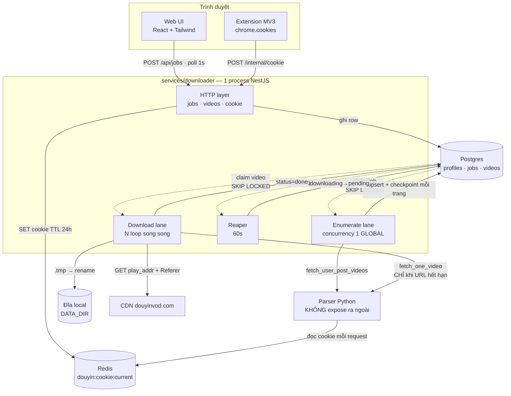
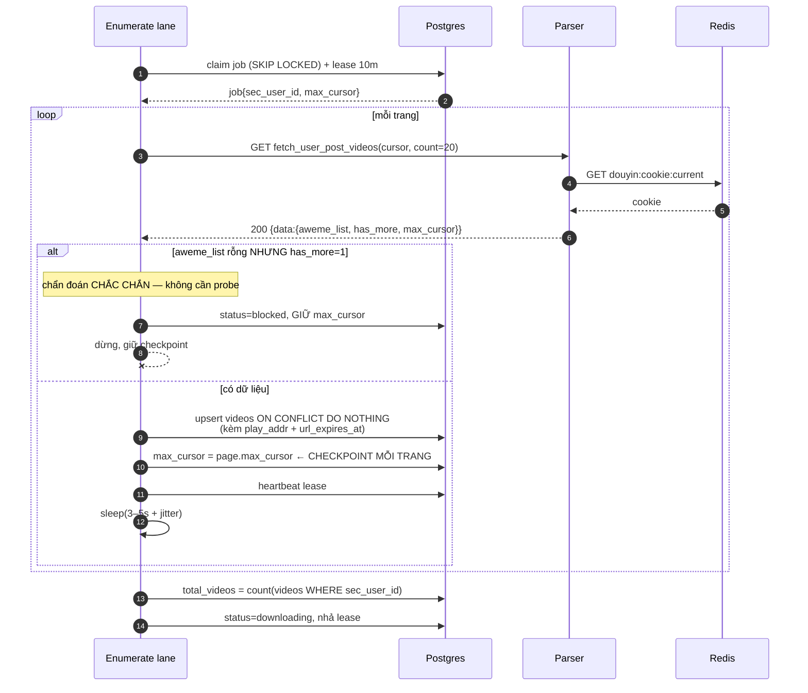
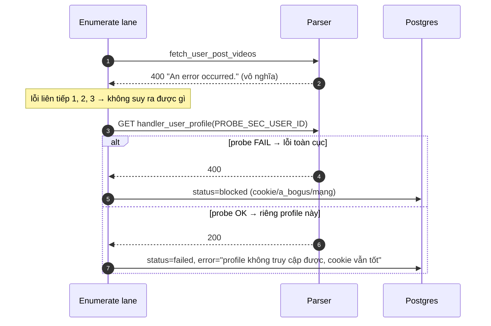
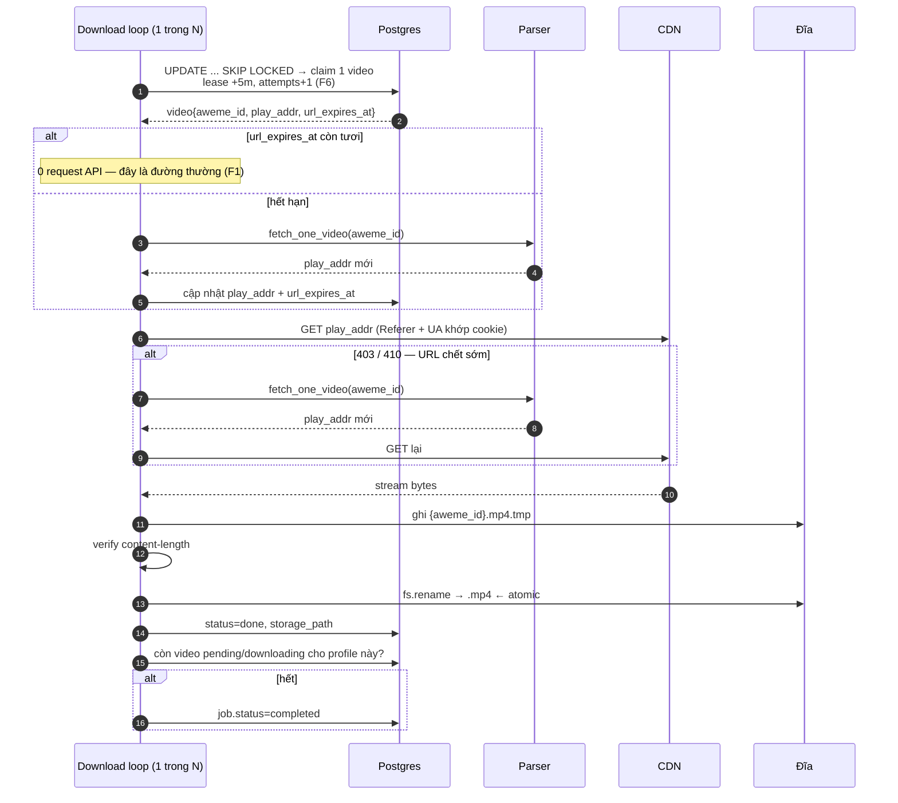

# Solution Design: Douyin Profile Bulk Downloader

**Author:** Solution Architect (via /solution-design)
**Date:** 2026-08-24
**Brainstorm ref:** `plans/reports/260824-2126-douyin-downloader-brainstorm.md`
**Status:** draft

---

## 1. Context

**Problem.** Dán link profile Douyin → tải toàn bộ video tab "Đã đăng" về đĩa. Job chạy nền hàng giờ, có tiến độ, resume sau crash, chạy lại chỉ tải phần mới. Cookie do Chrome extension MV3 tự thu và push xuống backend.

**Constraints (đã chốt ở brainstorm, không mở lại):**

| | |
|---|---|
| D1 | TypeScript + NestJS. Parser Python là container HTTP riêng (không import được) |
| D2 | API + worker **chung 1 process** |
| D3 | Postgres (cần `FOR UPDATE SKIP LOCKED`) |
| D4 | Đĩa local sau interface `Storage` |
| D5 | **DB làm queue**, không broker |
| D6 | Polling 1s, không SSE ở v1 |
| D7 | Monorepo `services/`, deploy độc lập |
| D8 | `X-Api-Key` |
| F1 | Cache `play_addr` + `url_expires_at`, re-resolve **phản ứng** khi hết hạn/403/410 |
| F2 | Enumerate lane concurrency = **1 toàn hệ thống** (rate limit theo IP) |
| F3 | `lease_expires_at` + reaper |

**Success criteria.** 9 tiêu chí ở §12 brainstorm. Hai cái định hình kiến trúc mạnh nhất: *kill worker giữa job → resume, không tải lại* và *cookie hết hạn → `blocked` không `failed`, push cookie mới → tiếp từ checkpoint*.

**Non-goals.** Tab Thích/Sưu tầm/live · TikTok · multi-tenant · transcode/thumbnail/subtitle · SSE · dubbing/publish (service khác, không couple).

---

## 1.5 Bốn phát hiện mới trong bước design (chưa có ở brainstorm)

Đọc code parser lộ ra bốn thứ làm đổi thiết kế. **F5 và F6 là bug nếu không xử lý.**

### F4 — Parser bóp mọi lỗi thành HTTP 400 giống hệt nhau

`app/api/endpoints/douyin_web.py` bắt `except Exception` và trả `ErrorResponseModel` với `message` **mặc định tĩnh** `"An error occurred."` — `str(e)` không bao giờ được truyền vào.

Hệ quả: từ NestJS, bốn nguyên nhân sau **không phân biệt được**:

| Nguyên nhân thật | Remediation đúng | Nhìn thấy |
|---|---|---|
| Cookie bị ban | Push cookie mới → `blocked` | 400 |
| `a_bogus` lỗi thời | Pull upstream | 400 |
| Profile private / đã xoá | Job `failed`, thông báo user | 400 |
| Parser không ra được Douyin | Retry, chờ mạng | 400 |

IDEA.md §6.2 nói "3 lỗi liên tiếp → `blocked`" — nhưng làm thế sẽ **báo `blocked` cho profile private**, và người vận hành sẽ đi đổi cookie vô ích.

**Xử lý — probe disambiguation, không patch parser.** Ba tín hiệu, xếp theo độ tin cậy:

1. **Tín hiệu cấu trúc (đáng tin nhất, là HTTP 200):** `data.aweme_list` rỗng nhưng `data.has_more == 1` → cookie bị chặn. Đây là chẩn đoán *chắc chắn*, dùng ngay, không cần probe.
2. **3× HTTP 400 liên tiếp → chạy probe** `GET /api/douyin/web/handler_user_profile?sec_user_id=<PROBE_SEC_USER_ID>` (một profile public đã biết, đặt trong env).
   - Probe **fail** → lỗi toàn cục (cookie / `a_bogus` / mạng) → `blocked`
   - Probe **OK** → riêng profile này có vấn đề → `failed` kèm `error` nói rõ "profile không truy cập được, cookie vẫn tốt"
3. Probe tốn 1 request và **chỉ chạy trên đường lỗi**, nên không đụng vào ngân sách rate limit ở đường thường.

Không patch parser để lấy error text: sẽ đốt ngân sách `check-patch-size.sh` vào file upstream sở hữu, đúng loại nợ mà `PATCH_NOTES.md` được viết ra để tránh.

### F5 — `jobs` cũng cần lease, không chỉ `videos`

F3 ở brainstorm chỉ nói `videos`. Nhưng crash **giữa pha enumerate** để job đứng vĩnh viễn ở `status='enumerating'`: enumerate lane là global 1 luồng và nó chỉ nhặt job `pending`, nên job đó **không bao giờ được nhặt lại** — và vì lane global chỉ có 1, một job kẹt như vậy không chặn job khác nhưng chính nó thì chết hẳn.

Tiêu chí *"kill worker giữa job → resume"* sẽ **không đạt** cho pha enumerate. Thêm `jobs.lease_expires_at`, reaper trả `enumerating` quá hạn về `pending` (checkpoint `max_cursor` vẫn nguyên nên resume đúng chỗ).

### F6 — `attempts` tăng lúc claim, không lúc fail

Tăng lúc fail thì crash-loop **không bao giờ** tăng `attempts` → video bị claim lại vô hạn sau mỗi lần reaper nhả. Tăng lúc claim cho một chặn trên cứng cho tổng công sức mỗi video, bất kể fail kiểu gì.

**Đánh đổi chấp nhận:** 3 lần crash hạ một video xuống `failed` dù chưa thật sự tải lần nào. Người vận hành bấm `/retry` để reset. Đây là hướng an toàn hơn — nghiêng về dừng lại thay vì spin vô hạn.

### F7 — Tiến độ job đo theo **trạng thái profile**, không theo delta của job

`videos` khoá theo `aweme_id` toàn cục (không có `job_id`) — đó chính là cái làm incremental miễn phí. Hệ quả: job chạy lần 2 trên cùng profile không có video mới sẽ hiện **`340/340` ngay lập tức**.

Đây là **thông tin đúng** ("mọi thứ đã tải xong"), không phải bug, nhưng sẽ gây bất ngờ nếu không nói trước. Giữ nguyên vì thêm `job_id` vào `videos` phá vỡ dedupe toàn cục.

---

## 2. Approaches Evaluated

Trục còn mở là **lane chạy thế nào bên trong process NestJS**. Ba lựa chọn khác nhau về bản chất, không phải khác cú pháp.

### Approach 1: Lane = vòng lặp async sống lâu, tự lên lịch

Mỗi lane là một `async` loop khởi động ở `OnApplicationBootstrap`, tự `await sleep()` giữa các vòng, tự quyết nhịp. Enumerate lane: 1 loop. Download lane: N loop song song (N = `DOWNLOAD_CONCURRENCY`), mỗi loop độc lập claim-và-tải. Reaper: 1 loop nhịp 60s. Shutdown qua `AbortController` + `OnApplicationShutdown`.

**Pros:**
- `sleep(3–5s + jitter)` **giữa các trang trong cùng một job** là một dòng `await` ngay trong loop — đúng chỗ nó thuộc về. Đây là yêu cầu cứng của F2/§3.1 và là điểm quyết định.
- Concurrency download = số loop. Không cần semaphore, không cần đếm, không thể chạy quá N.
- Backpressure tự nhiên: loop chỉ claim việc mới khi đã xong việc cũ.
- Test được không cần Nest scheduler: gọi thẳng `runOnce()` trong unit test.

**Cons:**
- Phải tự viết lifecycle (start/stop/drain) — ~80 dòng `LaneRunner` base.
- Loop rò exception là chết lane âm thầm. Bắt buộc `try/catch` quanh toàn thân + log + tiếp tục.
- Không có sẵn dashboard/introspection như thư viện queue.

### Approach 2: `@nestjs/schedule` `@Interval()` poller

Mỗi lane là một method có decorator `@Interval(1000)`. Nest tự gọi định kỳ. Mỗi lần gọi claim tối đa 1 việc rồi trả về.

**Pros:**
- Idiomatic NestJS, lifecycle do framework lo, không tự viết runner.
- Dừng/khởi động lane bằng `SchedulerRegistry` — có sẵn API.
- Khó rò exception ra ngoài làm chết vòng lặp.

**Cons:**
- **Sai mô hình cho enumerate.** Nhịp là *giữa các tick*, không phải *giữa các trang của một job*. Muốn sleep 3–5s + jitter giữa trang thì phải hoặc (a) giữ state cursor ngoài method rồi mỗi tick làm 1 trang — biến DB thành nơi giữ trạng thái điều phối, hoặc (b) `await sleep()` trong tick → tick chồng nhau, mất luôn lợi ích của scheduler.
- Concurrency download phải tự đếm bằng semaphore vì mọi tick vào cùng một method.
- Tick chồng lấn nếu việc lâu hơn interval — phải tự khoá.

### Approach 3: Postgres `LISTEN/NOTIFY` event-driven

Bỏ polling. `INSERT` job phát `NOTIFY job_created`; video chuyển `pending` phát `NOTIFY video_ready`. Lane giữ connection `LISTEN` và thức khi có tín hiệu.

**Pros:**
- Không có polling rỗng, độ trễ gần bằng 0.
- Sạch về khái niệm: DB vẫn là chân lý duy nhất, chỉ thêm tín hiệu thức.

**Cons:**
- `NOTIFY` **không bền**. Mất khi connection đứt, và đó chính là lúc khủng hoảng (restart, reaper). Vẫn **buộc phải có** poller dự phòng ⇒ được thêm cơ chế thứ hai chứ không thay được cơ chế nào.
- Cần connection riêng ngoài pool, tự reconnect.
- Độ trễ 1s không ai cảm nhận trên job hàng giờ (đây chính là lý luận đã chốt D6) ⇒ giá trị mua được gần bằng 0.

---

## 3. Comparison

| Dimension | A1 loop tự lên lịch | A2 `@Interval` | A3 LISTEN/NOTIFY |
|---|---|---|---|
| Implementation effort | Trung bình (~80 dòng runner base) | Thấp | Cao (NOTIFY **+ vẫn phải có** poller) |
| Operational complexity | Thấp — 1 cơ chế | Thấp | Cao — 2 cơ chế, 1 cái không bền |
| Khớp yêu cầu rate limit F2 | ✅ sleep đúng chỗ, trong loop | ❌ nhịp sai tầng | ✅ (nhưng qua poller dự phòng) |
| Kiểm soát concurrency | ✅ = số loop, cấu trúc bảo đảm | ⚠️ tự đếm semaphore | ⚠️ tự đếm |
| Scalability ceiling | Đủ (1–3 user); tách process không đổi logic | Đủ | Đủ |
| Security surface | Không đổi | Không đổi | Thêm 1 connection dài hạn |
| Testability | ✅ gọi thẳng `runOnce()` | ⚠️ phải qua scheduler hoặc bóc method | ❌ cần Postgres thật để test tín hiệu |
| Team familiarity | Loop async là JS cơ bản | ✅ Nest chuẩn | ❌ ít gặp |
| Reversibility | ✅ tách ra process riêng: đổi 0 dòng logic | ✅ | ⚠️ NOTIFY dính vào 1 process |

---

## 4. Recommendation: Approach 1

**Why.** Ba dimension quyết định. **(1) Khớp rate limit** — F2 đòi sleep 3–5s + jitter *giữa các trang trong một job*; chỉ A1 đặt được nó đúng tầng, A2 phải bẻ nhịp hoặc bẻ scheduler. **(2) Kiểm soát concurrency bằng cấu trúc** — download = N loop nghĩa là không thể vượt N, còn A2/A3 phải tự đếm và semaphore đếm sai là bug âm thầm đúng loại khó tìm nhất. **(3) Testability** — `runOnce()` gọi trực tiếp cho phép mutation test từng guard theo yêu cầu §13 brainstorm mà không dựng scheduler.

**Trade-offs we accept.** A2 cho lifecycle miễn phí; ta trả bằng ~80 dòng `LaneRunner` base và **nghĩa vụ bắt hết exception trong thân loop** — loop rò exception là lane chết âm thầm, nên đây là một guard bắt buộc có mutation test, không phải một lời nhắc. A3 cho độ trễ thấp hơn; ta bỏ vì D6 đã kết luận độ trễ 1s vô nghĩa trên job hàng giờ, và vì `NOTIFY` không bền nên nó không loại bỏ được poller.

---

## 5. Core Workflow

### 5.1 Flowchart — end-to-end



**Ranh giới then chốt:** HTTP layer **không bao giờ** gọi lane. Nó chỉ ghi row. Lane chỉ đọc row. Đây là thứ làm việc tách lane ra process riêng sau này tốn 0 dòng logic — và nó được ESLint enforce (§7).

### 5.2 Sequence — enumerate, gồm cả điểm phát hiện `blocked`



Đường lỗi (F4):



### 5.3 Sequence — download, gồm F1 re-resolve phản ứng



### 5.4 Sequence — hồi phục sau crash + cookie mới (tiêu chí nghiệm thu khó nhất)

```mermaid
sequenceDiagram
    autonumber
    participant OP as Người vận hành
    participant EXT as Extension
    participant API as API
    participant R as Redis
    participant RP as Reaper
    participant PG as Postgres
    participant L as Lane

    Note over L,PG: cookie bị ban giữa job
    L->>PG: job.status=blocked, max_cursor GIỮ NGUYÊN
    Note over PG: videos đã done vẫn done — không tải lại

    OP->>EXT: đăng nhập lại Douyin, bấm "Push now"
    EXT->>API: POST /internal/cookie
    API->>R: SET douyin:cookie:current TTL 24h
    API->>R: SET douyin:cookie:pushed_at
    Note over R: parser đọc cookie mới ở request KẾ TIẾP<br/>KHÔNG restart (đã xong ở fork)

    OP->>API: POST /api/jobs/{id}/retry
    API->>PG: blocked→pending; videos failed→pending
    L->>PG: claim lại từ max_cursor  ← tiếp, không làm lại

    Note over RP,PG: nhánh song song: process bị kill
    RP->>PG: videos downloading + lease quá hạn → pending
    RP->>PG: jobs enumerating + lease quá hạn → pending  (F5)
```

---

## 6. Database Changes

Greenfield — DB chưa tồn tại. Tất cả là bảng mới.

### Bảng mới

**`profiles`**
| Cột | Kiểu | Ghi chú |
|---|---|---|
| `sec_user_id` | `text` PK | |
| `nickname` | `text` | từ `handler_user_profile` |
| `last_synced_at` | `timestamptz` | |

**`jobs`**
| Cột | Kiểu | Ghi chú |
|---|---|---|
| `id` | `uuid` PK | |
| `sec_user_id` | `text` → `profiles` | |
| `status` | `text` | `pending·enumerating·downloading·completed·failed·blocked·cancelled` |
| `total_videos` | `int` NULL | NULL tới khi enumerate xong |
| `enumerated_count` | `int` | job-local: số item quét được lần chạy này |
| `downloaded_count` / `failed_count` | `int` | dẫn xuất từ trạng thái profile — xem F7 |
| `max_cursor` | `bigint` | **checkpoint mỗi trang** |
| `lease_expires_at` | `timestamptz` NULL | **F5 — mới** |
| `error` | `text` | không bao giờ chứa cookie |
| `created_at` / `updated_at` | `timestamptz` | |

**`videos`**
| Cột | Kiểu | Ghi chú |
|---|---|---|
| `aweme_id` | `text` PK | **dedupe toàn cục ⇒ incremental miễn phí.** Không có `job_id` — cố ý (F7) |
| `sec_user_id` | `text` | |
| `desc` | `text` | |
| `create_time` | `timestamptz` | |
| `duration_ms` | `int` | |
| `play_addr` | `text` NULL | **F1 — mới** |
| `url_expires_at` | `timestamptz` NULL | **F1 — mới** |
| `storage_path` | `text` NULL | |
| `status` | `text` | `pending·downloading·done·failed·skipped` |
| `attempts` | `int` | tăng **lúc claim** (F6) |
| `last_error` | `text` | |
| `lease_expires_at` | `timestamptz` NULL | **F3 — mới** |

### Index

| Index | Phục vụ |
|---|---|
| `videos (status, create_time)` **partial** `WHERE status='pending'` | claim download — index nhỏ, chỉ chứa việc chưa làm |
| `videos (status, lease_expires_at)` **partial** `WHERE status='downloading'` | reaper |
| `videos (sec_user_id, create_time DESC)` | browse + đếm tiến độ |
| `jobs (status, created_at)` | claim enumerate |
| `jobs (status, lease_expires_at)` **partial** `WHERE status='enumerating'` | reaper (F5) |
| `jobs (sec_user_id)` | |

### Truy vấn claim (là hạt nhân của D5 — viết ra để không ai đoán)

```sql
-- claim 1 video để tải
UPDATE videos v SET
  status = 'downloading',
  lease_expires_at = now() + (:lease_seconds || ' seconds')::interval,
  attempts = v.attempts + 1                      -- F6: tăng lúc claim
WHERE v.aweme_id = (
  SELECT aweme_id FROM videos
  WHERE status = 'pending' AND attempts < :max_attempts
  ORDER BY create_time
  FOR UPDATE SKIP LOCKED
  LIMIT 1
)
RETURNING *;

-- reaper: nhặt lại việc mồ côi
UPDATE videos SET status='pending', lease_expires_at=NULL
WHERE status='downloading' AND lease_expires_at < now();

UPDATE jobs SET status='pending', lease_expires_at=NULL      -- F5
WHERE status='enumerating' AND lease_expires_at < now();
```

**Migration.** Forward `migrations/260824-init-schema.sql`, rollback = `DROP TABLE`. Không cần maintenance window (greenfield, chưa có dữ liệu).

**ORM.** Yêu cầu cứng: **phải diễn đạt được `FOR UPDATE SKIP LOCKED` không cần rơi xuống raw SQL**. Điều này **loại Prisma** (cần `$queryRaw`, mất type safety đúng chỗ quan trọng nhất). Đề xuất **Drizzle** (`.for('update', { skipLocked: true })`); TypeORM cũng đạt (`setLock` + `setOnLocked`). ⚠️ **API chính xác phải verify ở phase đầu bằng một integration test chạy 2 transaction song song** — không tin doc, tin test.

---

## 7. Key Changes

### Cấu trúc mới

```
services/downloader/
  src/
    main.ts                        bootstrap, graceful shutdown
    app.module.ts
    config/env.ts                  zod schema, fail-fast lúc bootstrap
    common/
      api-key.guard.ts             D8
      redact.logger.ts             chặn cookie vào log ở TẦNG LOGGER
      errors.ts
    db/
      schema.ts                    drizzle: profiles · jobs · videos
      migrations/260824-init-schema.sql
      client.ts
    parser/
      parser.client.ts             HTTP → Python. Bóc envelope {code,router,data}
      parser.errors.ts             F4: probe disambiguation
      parser.types.ts
    storage/
      storage.interface.ts         put · exists · freeBytes · remove
      local-disk.storage.ts        .tmp → fs.rename
    cookie/
      cookie.controller.ts         POST /internal/cookie · GET /internal/cookie/status
      cookie.service.ts            ghi Redis + pushed_at. KHÔNG BAO GIỜ đọc để trả về
    jobs/
      jobs.controller.ts           POST · GET · cancel · retry
      jobs.service.ts              url → sec_user_id qua parser, tạo row
      jobs.repository.ts
    videos/
      videos.controller.ts         browse
      videos.repository.ts
    lanes/
      lane.runner.ts               base: start/stop/drain, BẮT HẾT exception
      enumerate.lane.ts            concurrency 1 GLOBAL (F2)
      download.lane.ts             N loop
      reaper.ts                    videos + jobs (F3, F5)
  test/
    ...unit + integration + mutation
docker-compose.yml                 nest · parser · postgres · redis · web
```

### File sửa (ngoài `services/downloader`)

- `pnpm-workspace.yaml`, `package.json` gốc — **mới**, dựng workspace `services/*`
- `.github/workflows/ci.yml` — thêm job cho `services/downloader` (lint · unit · integration · mutation). **Giữ nguyên** job gitleaks + canary + `check-patch-size.sh` đang có
- `.eslintrc` trong `jobs/` + `videos/` — `no-restricted-imports` chặn `**/lanes/**`. Đây là cách enforce ranh giới ở §5.1: HTTP layer không được gọi lane
- `.gitignore` — thêm `DATA_DIR`

### Không sửa

`src/Douyin_TikTok_Download_API/**` — **không patch thêm** trong phạm vi này. F4 cố ý xử lý phía NestJS để không đốt ngân sách `check-patch-size.sh`.

---

## 8. Side Effects

### Module bị ảnh hưởng

| Module | Ảnh hưởng |
|---|---|
| Parser fork | **Không đổi code.** Nhưng lần đầu tiên có tải thật: enumerate 1 luồng + `fetch_one_video` rải rác. Đường async cookie (`resolve_cookie_async`, client cache theo event loop) lần đầu chịu tải đồng thời thật |
| Redis | Trước giờ chỉ có parser đọc. Giờ NestJS **ghi**. Thêm key thứ hai `douyin:cookie:pushed_at` — không đụng vào key parser đọc |
| CI hiện có | Thêm job mới; ba gate cũ (gitleaks canary · patch-size · pytest fork) **phải giữ nguyên**, không được gộp |

### Feature có thể regress

| | Rủi ro | Test |
|---|---|---|
| Cơ chế đổi cookie runtime (đã xong ở phase 1) | Concurrency thật có thể lộ bug cache theo event loop mà unit test bỏ sót — journal phase 1 nói rõ integration test "2 event loop trong lifecycle parser thật" **vẫn chưa tồn tại** | Integration test: đổi key Redis giữa lúc N request đang bay, khẳng định request kế tiếp dùng cookie mới, không restart |
| Ngân sách rate limit | Job thứ 2 phải xếp hàng, không được chạy song song (F2) | Test: 2 job → đo tần suất request = 1 luồng |

### Breaking changes

Không có — greenfield. `POST /api/hybrid/update_cookie` của upstream đã chết từ phase 1 (cố ý, `update_cookie()` bị xoá); thiết kế này **không hồi sinh** nó.

### Vùng cần test dày thêm

- Đường claim (`SKIP LOCKED`) dưới N loop song song — **kiểm không có video nào bị claim 2 lần**
- Reaper vs worker đang chạy — đua giữa heartbeat và hết lease
- Cancel giữa lúc đang tải — abort stream, dọn `.tmp`
- `attempts` lúc claim (F6) — 3 crash liên tiếp phải ra `failed`, không loop vô hạn
- Mọi đường có cookie đi qua — redaction ở tầng logger

---

## 9. Dependencies

**Service ngoài:** Douyin web API (qua parser) · CDN `*.douyinvod.com` · Chrome (extension MV3).

**Thư viện mới:** NestJS (core·config·testing) · Drizzle + `pg` · `ioredis` · `zod` · `undici` (HTTP tới parser + CDN, có stream) · React + Vite + Tailwind. **Không** BullMQ. **Không** MinIO SDK.

**Container:** `nest` · `parser` (không `ports:`) · `postgres` · `redis` · `web`.

---

## 10. Risks & Mitigations

| Risk | L | I | Mitigation |
|---|---|---|---|
| Loop rò exception → lane chết âm thầm | M | **H** | `try/catch` toàn thân trong `LaneRunner` + metric "lane tick cuối cùng lúc nào". **Mutation test bắt buộc:** ném lỗi trong thân loop, khẳng định lane vẫn sống |
| `SKIP LOCKED` viết sai → tải trùng | M | **H** | Integration test 2 transaction song song. Không tin doc ORM |
| Chẩn đoán `blocked` sai (F4) | M | M | Ưu tiên tín hiệu cấu trúc (`aweme_list` rỗng + `has_more=1`); probe chỉ để phân biệt sau 3× 400 |
| Cookie lọt vào log | L | **H** | Redact ở **tầng logger**, không ở từng call site. Test khẳng định cả `caplog`-tương-đương **và** stdout/stderr — bài học phase 1: test cũ chỉ nhìn logging module nên `print()` lọt qua |
| Đầy đĩa giữa job | M | M | Preflight: `videos_count × 30MB` vs `freeBytes − 10GB` (xem Q3 §11) |
| Douyin đổi `a_bogus` | M | **H** | CI job hàng tuần (xem Q4 §11) |
| Reaper nhả video mà worker vẫn đang tải → 2 writer 1 file | L | **H** | Ghi vào `.tmp` **mang tên duy nhất theo lượt claim**, `rename` là điểm commit duy nhất. Worker hết lease phải tự huỷ, kiểm lease trước khi `rename` |
| Suite xanh nhưng guard mù | **H** | **H** | Bảng mutation test §13 brainstorm là **bắt buộc**, và phải verify mutation **thật sự match** — phase 1 có 2 lần `sed` match rỗng nên "vẫn xanh" là mutation tồi, không phải gap thật |

---

## 11. Open Questions

Bốn câu §14 brainstorm — **hai trả lời, hai hoãn có chủ ý**:

**Q1 — `DATA_DIR` mount ở đâu, quota bao nhiêu? → HOÃN đến lúc deploy.** Không chặn code: `DATA_DIR` là env, `Storage.freeBytes()` đọc lúc chạy. Thiết kế không giả định con số nào.

**Q2 — Preview video trong UI? → HOÃN đến M4, mặc định KHÔNG.** v1 API chỉ trả `storage_path`. Thêm serve static sau = một route Nest, additive, không breaking. Không xây trước.

**Q3 — Ngưỡng alert đĩa? → TRẢ LỜI.** Preflight **từ chối** job khi `total_videos × 30MB > freeBytes − 10GB`. 30MB là biên trên trong khoảng 5–30MB ở IDEA.md §11; 10GB là đệm để máy không chết vì đầy đĩa. Cả hai qua env. Chạy **sau** enumerate (lúc đó mới biết `total_videos`) và **trước** download, không phải lúc tạo job.

**Q4 — Lịch pull upstream? → TRẢ LỜI: CI job, không phải nhắc người.** GitHub Actions hàng tuần: fetch upstream → `check-patch-size.sh` → pytest fork → grep của `PATCH_NOTES.md` §5 (`headers["Cookie"]` trong `utils.py`) → mở issue nếu lệch. "Đặt lịch kiểm hàng tuần" trong IDEA.md §11 dựa vào con người nhớ; con người sẽ không nhớ. `PATCH_NOTES.md` tự nó ghi rằng nó chỉ mang tính khuyến nghị và không được CI enforce — đây là chỗ sửa điều đó.

**Còn mở, chưa chặn:** API chính xác của `FOR UPDATE SKIP LOCKED` trong Drizzle — verify bằng integration test ở phase đầu, không tin doc.

---

## 12. Next Steps

`/plan` với tài liệu này làm input. Bốn milestone M1–M4 ở §11 brainstorm là khung phase; F4–F7 phải rơi vào M1/M2 chứ không để cuối:

- **F5** (`jobs.lease`) và **F6** (`attempts` lúc claim) vào **M1 schema** — thêm cột sau khi có dữ liệu là migration, thêm ngay từ đầu là miễn phí
- **F4** (probe) vào **M2** cùng lúc với phát hiện `blocked`
- **F7** (tiến độ theo profile) là quyết định UX — nói rõ trong M1 để không ai "sửa" nó thành bug khác
